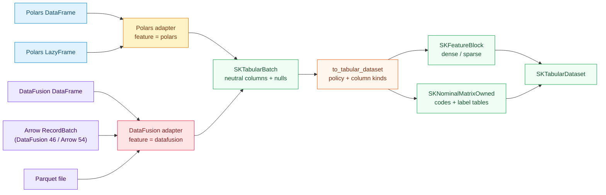

# Polars and DataFusion sources: one tabular contract for two engines

## 1. The problem we were solving

A data scientist rarely starts with a `Vec<f64>` or an `ndarray::Array2`. The data already
lives in a **DataFrame engine** such as Polars, in a **query engine** such as DataFusion, in
an **Arrow** `RecordBatch`, or on disk as Parquet. Before this change, using sciencekit meant
reselecting columns, renaming dtypes, converting missing values and reshaping rows by hand —
then repeating the whole exercise in reverse to export results.

The two engines look similar from a distance and different up close:

- **Polars** is an eager `DataFrame` plus a lazy query plan (`LazyFrame`). Its own Arrow fork
  is private; a series is a typed, nullable column, and category columns are physically
  dictionary codes.
- **DataFusion** is a SQL query engine. A `DataFrame` is an unexecuted logical plan that
  produces Arrow `RecordBatch` values. DataFusion 46 carries Arrow **54**, while the rest of
  this repository already speaks Arrow **58**.

Adding either engine to the default build would drag a large dependency graph into every
user of the library. The change therefore had three jobs:

1. define **one materialized table contract** that both engines can feed;
2. keep each engine behind an **optional feature** (`polars`, `datafusion`);
3. map missing values and categories **once**, in the neutral layer, so an estimator never
   learns which engine produced its matrix.

The result is `sciencekit_interop::tabular`. It reuses the batch pipeline that already
existed (`SKTabularBatch`, `SKMissingValuePolicy`, `SKColumnSelection`) rather than
duplicating it.

---

## 2. The idea in one picture

Everything in blue and violet is **engine-specific and optional**. Everything in green and
orange is compiled into every build and has no engine dependency.

---

## 3. The decisions — and the roads not taken

### 3.1 A dataset, not a second "source"

The original plan called the materialized value `SKTabularSource<F>`. That name was already
taken by the reopenable batch trait in `sciencekit_interop::source`, which every streaming
adapter implements. Keeping two meanings of *source* would have made imports and
documentation ambiguous. The materialized value is therefore
`sciencekit_interop::tabular::SKTabularDataset<F>`, while `SKTabularSource` keeps its
streaming meaning. The design document records this naming deviation explicitly.

### 3.2 Reuse the batch pipeline

The adapters do **not** build matrices directly. They produce `SKTabularBatch` values, the
same neutral column-major batch used by the Arrow adapter. The existing materializer then
handles:

- numeric coercion and integer widening (`sk_coerce_numeric_column`);
- boolean-to-`0`/`1` mapping;
- missing-value policy (`Reject`, `NumericNaN`, `CategoricalMissingCode`, `ConstantFill`);
- dense or sparse feature blocks (`SKFeatureLayout`);
- categorical canonicalization through `sk_canonicalize_labels`.

This is why the chapter talks about a *contract* rather than two new importers. The engines
only translate their dtype vocabularies.

### 3.3 Column kinds, not roles

`SKColumnRole` already answers "is this a feature, a target or ignored?" for the supervised
batch path. The tabular contract needs a different question: "how does this column enter the
materialized outputs?" `SKColumnKind` answers it with four values:

| Kind | Enters | Mapping |
|---|---|---|
| `Numeric` | feature block | `f32`/`f64` directly, integers widened to the scalar |
| `Boolean` | feature block | `true → 1`, `false → 0` |
| `Categorical` | categorical block | strings canonicalized to codes + label table |
| `Ignored` | nothing | dropped from outputs and from the projected schema |

`SKTabularSourceConfig` is the validated list of `(name, kind)` pairs plus the missing-value
policy and the requested layout. Its builder rejects an empty list and duplicate names before
a single row is read. An ignored column may even be absent from the adapter batch: the
materializer skips it either way.

### 3.4 Missing values have exactly one mapping

Numeric and boolean nulls become `NaN` under `SKMissingValuePolicy::NumericNaN`. Categorical
nulls become `SK_CATEGORICAL_MISSING_CODE` (`-1`) under
`SKMissingValuePolicy::CategoricalMissingCode`. The default remains `Reject`, so a caller
must acknowledge nullability rather than inheriting an engine's opinion. A null is never
silently turned into zero, because zero is a real measurement.

### 3.5 Version pins are part of the contract

The workspace targets Rust 1.85. Both engines float toward newer toolchains unless pinned:

- **Polars 0.46** builds on 1.85 only when `psm` is pinned to **0.1.28**; newer `psm`
  releases pull `ar_archive_writer` 0.5, which uses let-chains stabilized in Rust 1.88.
- **DataFusion 46** (MSRV 1.82) builds on 1.85 once `comfy-table`, pulled through
  `arrow-cast` 54, is pinned to **7.1.4** for the same reason.

Both pins live in `crates/sciencekit_interop/Cargo.toml` with comments, and each is attached
to the corresponding optional feature, so the default build resolves neither engine. The
lockfile is not committed (the repository ignores it for a library), which is exactly why the
pins must be declared in the manifest.

### 3.6 Roads not taken

- **One shared Arrow crate.** DataFusion 46 pins Arrow 54 while the repository speaks Arrow
  58. Mixing both in one public type would leak two incompatible `RecordBatch` types.
  Instead the DataFusion adapter maps its own Arrow vocabulary into neutral columns and never
  exposes a DataFusion Arrow type publicly.
- **Unsafe C Data Interface bridging between the two Arrow versions.** The crate denies
  `unsafe_code`, and a cross-version FFI hop would be unverifiable at the byte level. The
  safe downcast-based reader is slower per cell but auditable.
- **Encoding categorical columns into one-hot features.** That would silently change the
  model's input width and contradict the existing categorical contract, which carries codes
  and label tables.
- **Writing back to Polars or DataFusion.** The change is additive and import-only.

---

## 4. The public objects

### `SKTabularDataset<F>`

Built by `SKTabularDataset::new(schema, features, categorical)`. The constructor checks that
the numeric and categorical blocks agree on the row count and that the projected schema width
equals the numeric width plus the categorical width. It exposes `schema()`, `features()`,
`feature_view()` (a zero-copy `SKDataView`), `categorical()`, `number_of_rows()`,
`number_of_feature_columns()`, `number_of_categorical_columns()` and `into_parts()`.

### `SKNominalMatrixOwned`

An owned code matrix (`ndarray::Array2<i64>`) plus one `Option<SKLabelTable>` per column.
Codes use the documented missing sentinel. `with_view` lends it as
`SKCategoricalView::Integer`, so no string copy is needed at read time.

### `SKTabularSourceConfig` and `SKColumnKind`

The builder-only configuration described above. `column`, `missing_value_policy` and `layout`
are the only setters; `build` validates the surface.

### `SKTabularBatch::to_tabular_dataset`

The neutral materializer. It resolves the configured names against the batch schema, validates
each kind against the column's logical type, builds the feature selection and the categorical
selection, and assembles the dataset. An unknown name returns `UnknownColumn` listing what the
source actually carries; a kind/type mismatch returns `UnsupportedColumnType` naming the
column.

### Polars surface (`feature = "polars"`)

- `sk_tabular_batch_from_dataframe(frame, config, position, is_final)`
- `sk_tabular_dataset_from_dataframe::<F>(frame, config)`
- `TryFrom<(&DataFrame, &SKTabularSourceConfig)> for SKTabularDataset<F>`
- `SKPolarsLazySource::new(lazy_frame, config, batch_size)` implementing `SKTabularSource`

Polars 0.46 exposes no incremental sink over a `LazyFrame`. The lazy source therefore executes
the plan once per `open`, then slices the executed frame into owned batches of at most
`batch_size` rows. This keeps downstream memory bounded per block and preserves row order, but
it is an honest limitation: the plan itself is not pulled row by row. The struct documents
this in its type-level comment.

### DataFusion surface (`feature = "datafusion"`)

- `sk_tabular_batch_from_datafusion_record_batch`
- `sk_tabular_batches_from_dataframe` (async), `sk_tabular_dataset_from_dataframe` (async),
  `sk_tabular_dataset_from_dataframe_blocking` (sync, refuses to nest inside a Tokio runtime)
- `TryFrom<(&DataFrame, &SKTabularSourceConfig)> for SKTabularDataset<F>`
- `SKDataFusionStreamSource`, a genuine streaming source over `execute_stream`
- `sk_dataframe_from_parquet`, `sk_tabular_dataset_from_parquet` and its blocking twin

`SKDataFusionStreamSource` buffers exactly one record batch ahead, only to know whether the
current block is final. That keeps the `is_final` contract without collecting the result set.

---

## 5. Walking the real tests

The tests are the executable specification; each name below is a test in the repository.

### Tabular contract

- `tabular_source_numeric_columns_form_feature_block_in_order` builds a mixed batch with
  `x`, `count`, `flag`, `label` and an ignored `note`, then asserts the dense matrix is
  `[[1, 10, 1], [2, 20, 0], [3, 30, 1]]` in configuration order.
- `tabular_source_ignored_columns_are_excluded` checks that `note` is absent from the projected
  schema and that only one categorical column remains.
- `tabular_missing_numeric_null_becomes_nan` and
  `tabular_missing_categorical_null_becomes_sentinel` pin the two missing mappings.
- `tabular_source_kind_mismatch_names_the_column` declares the text column `label` numeric and
  expects `UnsupportedColumnType` naming `label`.

### Polars

- `polars_dataframe_maps_numeric_columns_in_order` exercises `f64`, `i32` and `bool` in one
  frame.
- `polars_dataframe_reads_categorical_dtype_as_text` casts a string series to Polars'
  `Categorical` dtype and proves it is read through its labels, not its internal codes.
- `polars_lazy_source_streams_ordered_batches` opens a five-row lazy frame with
  `batch_size = 2`, expects positions `0, 1, 2`, then reopens the source and reads the first
  batch again — the reopenability contract.
- `polars_acceptance_large_table_and_concurrent_reads` runs a one-row and a 2,000-row frame,
  then compares four thread reads against the single-threaded matrix with `NaN` normalized.

### DataFusion

- `datafusion_record_batch_maps_columns_in_config_order` builds Arrow 54 arrays directly.
- `datafusion_dataframe_converts_to_dataset` goes through `SessionContext::read_batch` and the
  blocking conversion.
- `datafusion_stream_source_preserves_order_and_final_flag` asserts positions start at zero,
  exactly the last batch is final, and a second `open` yields another batch.
- `datafusion_parquet_converts_with_the_same_rules` writes a Parquet fixture with
  `datafusion::parquet::arrow::ArrowWriter`, reads it back through a temporary
  `SessionContext`, and checks the same numeric/categorical result.
- `datafusion_dataset_reads_agree_across_threads` wraps the dataset in `Arc` and compares four
  worker reads.

### Gates

The change runs `cargo fmt --all --check`, `cargo clippy --workspace --all-targets -- -D
warnings`, `cargo test --workspace`, and the interop suite with
`--features polars,datafusion,arrow`. The combined feature run matters: it proves that
DataFusion's Arrow 54 and the repository's Arrow 58 can coexist in one build without a type
collision.

---

## 6. What to remember

1. A DataFrame engine and a query engine can share **one** materialized contract if the
   contract is defined on neutral columns, not on engine types.
2. Feature gates keep the heavy dependency graph out of the default build; the pins that make
   the features work on Rust 1.85 are as important as the code.
3. Missing values and categories are mapped once, in the neutral layer, under an explicit
   policy.
4. Streaming is a property of the source trait, not of the materialized dataset; Polars offers
   batch slicing after execution, DataFusion offers a true record-batch stream, and both are
   documented for what they are.
