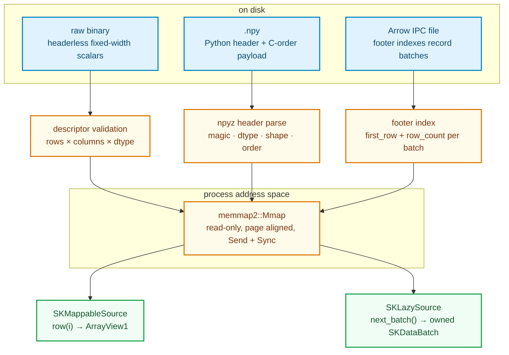

# Memory-mapped sources: touching a dataset instead of copying it

Every chapter before this one consumed data through a copy. A `Vec`, an `Array2`, a
`SKDataBatch` — even the streaming chapters copied each block from a reader into memory before an
estimator saw it. That is fine while the dataset fits in RAM, and the PRD's out-of-core promise
(§4.4) says it must not be a requirement. A dataset can be **larger than memory**, and the
estimators listed in the PRD (`SKKMeans`, k-NN, `SKDBSCAN`, decision trees) ask for **row 900 000**
by index, not for "the next batch". This chapter tells the story of the `memmap` feature of
`sciencekit_interop`: raw binary matrices, NumPy `.npy` files and Arrow IPC files exposed as
zero-copy, randomly addressable sources, each also usable as a sequential block source.

Everything here lives behind the crate feature `memmap`; with the feature off the crate compiles
exactly as before. The two new dependencies are `memmap2`, which asks the operating system to map a
file into the process address space, and `npyz`, which parses the Python-literal header of a `.npy`
file.

---

## 1. The idea in plain words: the file is already in memory

Modern operating systems give every process a **virtual address space**. A program can reserve a
range of addresses and tell the kernel: "the bytes behind these addresses are the contents of this
file". Nothing is read yet. The call returns immediately; the mapping is a promise, not a copy.

The bytes arrive later, one **page** at a time (typically 4 KiB), the first time the program touches
that page. The CPU raises a **page fault**, the kernel reads the page from disk into the page cache,
and the instruction that touched it resumes. If the same bytes are needed again, the page is already
resident and no disk I/O happens. The kernel can also evict clean pages under memory pressure because
the file is the backing store — the data is not lost, it can be read again.

This has three consequences that shape the whole design:

1. **Random access is genuinely random.** Reading row 1 000 000 of a column-major-free matrix costs
   one address computation plus the page faults of the columns touched by that row — never a scan
   of the preceding rows.
2. **Resident memory is bounded by what you touch**, not by the file size. A 40 GiB file can be
   queried on a 4 GiB machine.
3. **A view into the mapping borrows the file.** The bytes are owned by the kernel, not by the
   process, so the source must keep the mapping alive exactly as long as any returned row view.

`SKMappableSource<F>` already existed in `sciencekit_common`, precisely so algorithms never learn
where bytes come from:

```rust
pub trait SKMappableSource<F> {
    type Error: From<SKError>;
    fn number_of_rows(&self) -> usize;
    fn row(&self, index: usize) -> Result<ArrayView1<'_, F>, Self::Error>;
}
```

The returned `ArrayView1<'_, F>` borrows the source. That signature is what forces the design in
the next sections: a row must be a **contiguous, aligned slice of `F`** that outlives the call and
lives inside the mapping.

---

## 2. The shape of the feature



Every source implements both contracts. `row` returns a borrowed view; `next_batch` copies at most
a configured number of rows into an owned `SKDataBatch`. The same object can therefore serve a
random-access estimator or the streaming driver without opening the file twice.

### Decisions, and the roads not taken

| Decision | Why | Alternatives discarded |
|---|---|---|
| **`Arc<Mmap>` inside each source** | A `Mmap` is stable when moved and is `Send + Sync`; an `Arc` lets concurrent readers share it. | `Box<Mmap>` (cannot clone for threads), a bare slice (lifetime cannot outlive the file). |
| **`unsafe` confined to one byte-to-scalar helper** | Producing `&[F]` from raw bytes requires `from_raw_parts`. `sk_scalar_slice` validates alignment and length once and carries a `SAFETY` comment. The Arrow cache uses `OnceLock`, so its row views need no `unsafe` at all. | Scattering `unsafe` through the sources; pretending `transmute` is safe. |
| **Descriptor instead of guessing a raw shape** | `rows × columns` has many factorisations; any guess would be plausible and wrong half the time. A sidecar JSON (`{"rows": 1024, "columns": 8, "dtype": "f64"}`) is explicit and detectable. | Inferring the shape from file length. |
| **Zero-copy only when the dtype matches** | An `f64` view cannot alias `f4` bytes. The documented cast path materialises the matrix once. | Silently converting per row (a hidden copy per access), rejecting all casts. |
| **Alignment checked before exposing views** | `.npy` pads its header to 64 bytes, which is *usually* but not necessarily a multiple of the element size. An unaligned `&f64` is undefined behaviour. | `read_unaligned` per value (a copy and a different API), assuming headers are always friendly. |
| **Arrow: footer index, batch decode on demand** | The footer knows every batch's offset and row count. `row(i)` binary-searches the cumulative offsets and decodes exactly one batch. | Decoding every batch on open (linear in file size), scanning batches from the start. |
| **Sequential blocks are owned** | `SKDataBatch` is moved to another thread by the prefetch driver, so it cannot borrow the mapping. | Borrowed batches (does not fit the executor contract). |
| **Structured errors from the central taxonomy** | Every opening failure names the file and the reason (`MissingMappedFile`, `MappedLengthMismatch`, `MalformedMappedHeader`, `MisalignedMappedData`, `UnsupportedMappedDtype`, `NonLittleEndianMappedData`, `UnreadableMappedBatch`). | Panics, or a single opaque `Io` error. |

---

## 3. Raw binary: explicit shape, exact length

A raw file is the simplest case and the strictest one. `SKRawBinaryDescriptor` carries `rows`,
`columns`, `dtype` and an optional `endianness` (little by default). `SKRawBinaryMappableSource::open`
performs four checks **before** any row can be read:

1. the descriptor must be little-endian, otherwise `SKError::NonLittleEndianMappedData`;
2. its dtype must equal the model scalar (`F::SCALAR_NAME`), otherwise
   `SKError::UnsupportedMappedDtype`;
3. `rows × columns × element_size` must equal the file length exactly, otherwise
   `SKError::MappedLengthMismatch` naming the file, the expected and the actual byte counts;
4. the payload must be aligned for `F`, checked by `sk_scalar_slice`.

Only then is the mapping retained. `row(index)` computes `index * number_of_columns`, slices the
mapped scalars and reshapes them with `ArrayView1::from_shape` — no loop over preceding rows. The
unit test `random_access_does_not_scan_or_copy` builds a million-row file and asserts that row
900 000 is correct **and** that its address equals
`mapped_payload_address() + 900_000 × columns × 8`.

---

## 4. NumPy `.npy`: a header we must understand

A `.npy` file is a small text header followed by the array payload:

```text
offset 0      6 bytes   \x93NUMPY      magic
offset 6      1 byte    major version  1, 2 or 3
offset 7      1 byte    minor version
offset 8      2 or 4    header length  u16 for v1, u32 for v2/3
offset 10/12  L bytes   Python dict:  {'descr': '<f8', 'fortran_order': False,
                                        'shape': (3, 2), }
offset 10+L   ...       raw C-order payload
```

`npyz::NpyHeader::from_reader` parses the dictionary and gives the dtype, shape and order. The
adapter separately computes the payload offset from the framing bytes, because the mapping must
start at that exact byte. It then applies a small policy:

- **Fortran order is rejected** with `SKError::UnsupportedOperation` whose message suggests
  `numpy.ascontiguousarray`; a column-major array cannot be viewed as row-major rows.
- **Big-endian dtypes are rejected** with `SKError::NonLittleEndianMappedData`.
- **`f4` for an `f32` model and `f8` for an `f64` model are zero-copy.** `is_zero_copy()` is true
  and `mapped_payload_address()` names the first payload byte; the test
  `float64_rows_alias_the_mapping` asserts that a row pointer is exactly that address plus the row
  offset.
- **`int64` (and float dtypes that differ from the model scalar) require `open_with_cast`.** That
  path materialises the matrix once into an owned `Array2<F>`; the test
  `int64_with_cast_materializes_values` shows the values and asserts `!is_zero_copy()`. Opening
  without the cast returns `UnsupportedMappedDtype` and names the casting method.
- **Misalignment is a structured error, not undefined behaviour.** The fixture writer can emit a
  header whose length deliberately puts the payload at an odd address; the test
  `misaligned_header_payload_is_rejected` expects `MisalignedMappedData`, and the cast path is the
  documented remedy.

The header parser itself is tested for a corrupt magic (`malformed_header_is_rejected_without_panicking`),
a file ending inside the framing (`truncated_header_is_rejected`) and a payload shorter or longer
than the declared shape (`length_mismatch_is_rejected`). Because a file is untrusted input, the
byte-length multiplication is `checked`: `absurd_npy_dimension_is_a_typed_error` declares a shape
whose element count fits `usize` while its byte count does not, and expects
`MalformedMappedHeader` instead of an overflow panic. The hostile-input suite pairs it with a
truncated raw file and a wrong raw shape descriptor, each returning a typed error.

---

## 5. Arrow IPC: index the batches, decode one

Arrow is columnar. Inside a record batch, every column is a separate contiguous buffer, so a
**row is not contiguous** — it interleaves values from several columns. Zero-copy row views are
therefore impossible in general. What the adapter can avoid is decoding *the whole file* to answer
one row.

An Arrow IPC **file** ends with a FlatBuffer footer followed by its length and the `ARROW1` magic.
The footer lists every record batch's offset, metadata length and body length, plus the schema.
`sk_read_ipc_layout` reads only that footer and, for each block, parses the encapsulated message
metadata to obtain the row count — the body buffers are never touched. It builds a cumulative index
`first_row → number_of_rows` and validates that every block lies inside the file, so a truncated
file fails **on open** (`MalformedMappedHeader`) rather than faulting later. The row-count
accumulation uses `checked_add`, so a crafted footer cannot wrap the row space; the
`arrow_ipc_layout_tests` cover both the normal accumulation and the overflow rejection.

`SKArrowIpcMappableSource::row(index)` then:

1. binary-searches the cumulative offsets (`partition_point`) to find the containing batch;
2. decodes that one batch through `FileReader`, materialises it as row-major `F` values in a boxed
   slice, and caches it in a `Vec<OnceLock<Box<[F]>>>`;
3. returns an `ArrayView1` over the cached slice through an ordinary shared reference.

The cache is the one place where a returned view is produced from interior mutability. It needs no
`unsafe`: `OnceLock::get` hands out `&Box<[F]>` tied to the source's lifetime, and a slot is filled
once and never replaced or removed, so a concurrent reader either wins the race or drops its
identical copy. Before slicing, the row offset is multiplied with `checked_mul` and bounded against
the decoded batch length, so crafted batch metadata becomes `UnreadableMappedBatch` instead of an
out-of-bounds read. Concurrent readers are exercised by
`eight_threads_read_disjoint_rows_from_an_ipc_file`; `opening_indexes_batches_without_decoding_them`
asserts `decoded_batch_count() == 0` right after open and
`row_lookup_decodes_only_the_containing_batch` shows the count rise only for the batches actually
touched.

---

## 6. Sequential streaming, bounded batches, concurrency

`SKLazySource<F>` wants owned batches. `sk_next_mapped_block` reads at most `block_size` rows through
the same `row` accessor, copies them into an `Array2<F>`, wraps it in `SKDataBatch::new_dense`, and
marks the last block final. The cursor is an `AtomicUsize` so the source stays `Sync`; `next_batch`
takes `&mut self` but the row reads themselves are shared.

This is where the two contracts meet: a single open source can answer random row requests and, later,
stream the file once. The tests `sequential_blocks_respect_the_block_size_and_mark_the_last`,
`sequential_blocks_match_random_access` and `sequential_streaming_agrees_with_random_access` check
that the concatenation of the sequential blocks equals the random-access rows in order, that no
block exceeds the configured size, and that exactly one block is final. The large-file test
`a_large_file_streams_in_bounded_batches` runs 10 000 rows through a 512-row block size and asserts
each batch's resident `byte_size()` stays inside `512 × columns × 8` bytes.

All three sources are `Send + Sync` (asserted at compile time by
`mapped_sources_are_send_and_sync`) and are read by eight threads over disjoint rows in
`eight_threads_read_disjoint_rows_from_a_raw_file`,
`..._from_a_numpy_file` and `..._from_an_ipc_file`. Reading is shared; only the sequential cursor and
the per-batch `OnceLock` slots change, and each slot is written at most once.

---

## 7. The public objects, one by one

| Object | Where | What it does |
|---|---|---|
| `SKRawBinaryDescriptor`, `SKRawBinaryDtype`, `SKRawBinaryEndianness` | `memmap::descriptor` | Shape, dtype and byte order of a headerless matrix; JSON sidecar parsing with `from_json` / `from_sidecar`. |
| `SKRawBinaryMappableSource<F>` | `memmap::raw_binary_source` | Maps a raw file, implements `SKMappableSource<F>` and `SKLazySource<F>`; `with_block_size`, `mapped_payload_address`. |
| `SKNumpyMappableSource<F>` | `memmap::numpy_source` | Maps a `.npy` matrix; `open` is zero-copy for a matching dtype, `open_with_cast` materialises; `is_zero_copy`, `dtype_name`, `mapped_payload_address`. |
| `SKArrowIpcMappableSource<F>` | `memmap::arrow_ipc_source` | Maps an IPC file and indexes its batches; `number_of_batches`, `decoded_batch_count`, `row` and `next_batch`. |
| `sk_check_alignment`, `sk_scalar_slice` | `memmap::alignment` (crate-internal) | The only byte-to-scalar casts; validate alignment and length. |
| `sk_next_mapped_block` | `memmap::sequential` (crate-internal) | Copies the next bounded block into an owned `SKDataBatch`. |
| `sk_read_ipc_layout` | `memmap::arrow_ipc_layout` (crate-internal) | Footer-only index of an Arrow IPC file. |

All sources use the repository's naming rules (`SK` on types, `sk_` on free functions), keep the
implementation in folder modules with a pure-dispatcher `mod.rs`, and put every companion test in a
`*_tests.rs` file beside the implementation.

---

## 8. Limits, and what we deliberately did not build

Mapping a file assumes nobody else truncates or rewrites it while it is mapped. The adapters
validate the length at open, which removes the common SIGBUS case, but a file truncated **after**
open can still fault; the documentation states that mutation is undefined and the tests use immutable
fixtures. Windows read-only mapping also differs in its sharing semantics; CI targets Linux/macOS.

Out of scope, on purpose: CSV and JSON (not fixed-width, they stream through the Arrow adapter),
Parquet random row access (row groups, not rows, are the unit), `.npz` archives, compressed `.npy`,
Fortran order and big-endian raw files. Each of these would either break zero-copy or need a
materialising layer that already exists elsewhere.

---

## 9. Running the tests and the book

```sh
# The neutral crate, with the feature off:
cargo test -p sciencekit_interop

# The memory-mapped sources:
cargo test -p sciencekit_interop --features memmap
```

The feature matrix in CI runs both, and the `memmap` flag also enables the `arrow` adapter because
the IPC source builds on it. Build the book with:

```sh
mdbook build docs
```
