# Linear support-vector machines: coordinate descent, one sweep at a time

Chapter 41 built `SKSVC`, a kernel support-vector classifier that only ever touches the data
through a kernel matrix. That design is elegant, and it is the right answer whenever the
dataset is modest and the boundary has to bend — a few thousand rows, a radial basis
function, a curve that no straight line can follow. But it hides a scaling wall: an
$n \times n$ kernel matrix (or a cache of its rows) grows with the **square** of the number
of training rows. For $50\,000$ text documents the Gram matrix alone would need $20$ billion
entries. Text classification, the canonical linear-SVM workload, is exactly that regime: a
very large number of rows, a very large number of columns, and each row almost entirely
zero.

This chapter tells the story of `SKLinearSVC`, the linear member of the `sciencekit_svm`
family. It fits a **maximum-margin linear boundary** directly in the input space, with no
kernel matrix at all, using **dual coordinate descent** — the algorithm made practical by
Fan, Chang, Hsieh, Wang and Lin in *LIBLINEAR* (2008). The story is as much about the data
boundary as about the math: a CSR matrix with four stored entries per row must never be
expanded into a dense $20\,000 \times 10\,000$ block just to multiply it by a coefficient
vector.

```mermaid
flowchart LR
    accTitle: End-to-end flow of SKLinearSVC from data views to confidence margins
    accDescr: A borrowed dense view or a borrowed CSR view enters one-time representation dispatch. The dispatched design answers row dots and scaled-row accumulation over stored entries only. The dual coordinate-descent solver keeps an O(n) dual vector and an O(p) coefficient vector, then re-optimizes the unpenalized intercept. One-vs-rest heads are fitted in parallel and assembled into SKLinearSVCModel, which exposes decision_function and deterministic labels but deliberately refuses probabilities.
    A["SKDataView<br/>Dense or CSR, zero-copy"] --> B["SKLinearSvcDesign::dispatch<br/>(one match, once per operation)"]
    B --> C["SKDenseLinearSvcDesign<br/>row dot · add_scaled_row · ||x_i||²"]
    B --> D["SKSparseLinearSvcDesign<br/>stored entries only"]
    C --> E["Dual coordinate descent<br/>α ∈ Rⁿ · w ∈ Rᵖ⁺¹"]
    D --> E
    E --> F["Intercept recovery<br/>1-D bisection on the unpenalized loss"]
    F --> G["One-vs-rest heads<br/>parallel when the plan allows"]
    G --> H["SKLinearSVCModel<br/>decision_function · predict_labels"]
    H --> I["predict_probabilities<br/>UnsupportedOperation, by design"]
    classDef input fill:#dbeafe,stroke:#2563eb,stroke-width:2px,color:#1e3a8a
    classDef design fill:#fef9c3,stroke:#ca8a04,stroke-width:2px,color:#713f12
    classDef solver fill:#fde68a,stroke:#d97706,stroke-width:2px,color:#78350f
    classDef state fill:#ede9fe,stroke:#7c3aed,stroke-width:2px,color:#4c1d95
    classDef refusal fill:#fee2e2,stroke:#dc2626,stroke-width:2px,color:#7f1d1d
    class A input
    class B,C,D design
    class E,F,G solver
    class H state
    class I refusal
```



---

## 1. The idea, from zero

Imagine two clouds of points on a sheet of paper. A **linear classifier** draws a straight
line between them and labels a new point by which side of the line it falls on. Many lines
separate the clouds; which one should we pick?

A **support-vector machine** picks the line that leaves the widest empty corridor between the
two clouds. That corridor is the **margin**. The line is described by a weight vector $w$
and an intercept $b$, and every training row $(x_i, y_i)$ with $y_i \in \{-1, +1\}$ would
ideally satisfy

$$
y_i\,(w^\top x_i + b) \;\ge\; 1 .
$$

The left side is the **margin** of row $i$: positive means "correct side", and at least $1$
means "correct side, and outside the corridor". Real data trespasses. We therefore trade the
width of the corridor against the size of the trespass, with a knob $C$ that says how
expensive a trespass is:

- **L1 hinge loss** — every trespass costs $C$ per unit: $C \max(0,\,1 - y_i f(x_i))$.
- **L2 squared hinge loss** — the trespass is squared: $C \max(0,\,1 - y_i f(x_i))^2$.

Squaring makes the loss differentiable and punishes large violations harder; it is the
default of `SKLinearSVC`, matching LIBLINEAR's default solver. Written as one primal problem,

$$
\min_{w,\,b}\;\; \tfrac12 \lVert w \rVert_2^2 \;+\; C \sum_{i=1}^{n} \ell\!\left(1 - y_i (w^\top x_i + b)\right).
$$

The first term is the **regularizer**: it prefers short weight vectors, which is what makes
the corridor wide. The second term is the data fit. Neither loss is differentiable
everywhere (or, for the hinge, anywhere at the kink), so the primal is not a job for
gradient descent. The dual is.

### The dual, and why it is a gift for sparse data

Introduce one non-negative multiplier $\alpha_i$ per training row. The dual of the problem
above is

$$
\min_{\alpha}\;\; \tfrac12 \alpha^\top Q \alpha - \mathbf{1}^\top \alpha
\quad\text{subject to}\quad
0 \le \alpha_i \le C \;\;(\text{L1}),
\qquad
\alpha_i \ge 0 \;\;(\text{L2, shifted}),
$$

where the matrix entry is the pairwise inner product of signed rows,

$$
Q_{ij} = y_i\, y_j\, x_i^\top x_j .
$$

For the squared hinge, the diagonal carries an extra shift $D_{ii} = 1/(2C)$ — the dual is
strictly convex even when rows are duplicated. And the weight vector is not solved for at
all: it is **reconstructed exactly** from the multipliers,

$$
w = \sum_{i=1}^{n} \alpha_i\, y_i\, x_i .
$$

Notice what is *not* here. There is no Gram matrix materialized: the solver only ever needs
$Q_{ii}$ (one squared row norm) and, through $w$, one inner product per row. Notice also what
the dual buys us for sparse data: a row with four stored entries costs four multiply-adds
per sweep, not ten thousand.

---

## 2. Coordinate descent: one multiplier at a time

The dual is a box-constrained quadratic program with $n$ variables. A general QP solver
would need the matrix; coordinate descent never builds it. Each sweep visits every
coordinate $i$ and solves the one-dimensional problem exactly, holding all other $\alpha_j$
fixed:

$$
\alpha_i \;\leftarrow\; \operatorname{clip}\!\left(\alpha_i - \frac{G_i}{Q_{ii} + D_{ii}},\, 0,\, U_i\right),
$$

where $U_i = C \cdot \text{weight}_i$ for the hinge loss, $U_i = \infty$ for the squared
hinge, and $D_{ii}$ is the squared-hinge shift (zero for the hinge). The state maintained
between updates is just $w$, so the gradient component is cheap:

$$
G_i = y_i\, w^\top x_i - 1 + \alpha_i D_{ii}.
$$

The update is *projected* because a multiplier may not leave its box. The solver never
updates a coordinate that is already pinned at a bound and pushed further out: it first
forms the **projected gradient**

$$
PG_i =
\begin{cases}
\min(G_i, 0) & \alpha_i = 0,\\
\max(G_i, 0) & \alpha_i = U_i,\\
G_i & \text{otherwise},
\end{cases}
$$

and only moves when $|PG_i|$ is non-zero. A full sweep's stopping statistic is

$$
\max_i |PG_i| .
$$

When it falls below the configured `tolerance`, the dual has converged; when the sweep budget
`maximum_number_of_iterations` runs out first, `fit` returns the central
`NotConverged { iterations }` error instead of pretending the model is done. Both rules are
visible in `crates/sciencekit_svm/src/linear_svc/solver.rs`:

```rust
let gradient = labels[row] * design.row_dot(row, &coefficients) - F::one()
    + dual[row] * diagonal_shift;
let projected_gradient = if dual[row] <= F::zero() {
    gradient.min(F::zero())
} else if dual[row] >= upper_bound {
    gradient.max(F::zero())
} else {
    gradient
};
maximum_projected_gradient = maximum_projected_gradient.max(projected_gradient.abs());
```

Two properties matter beyond correctness. First, **determinism**: the multipliers start at
zero, coordinates are visited in index order, and no randomness enters, so repeated fits on
the same data are bit-identical. Second, **memory**: the solver holds an $O(n)$ dual vector
and an $O(p)$ coefficient vector. For the acceptance fixture of $20\,000$ rows and
$10\,000$ features that is about $234$ KiB of solver state, not the $1.6$ GB a dense design
would need.

### The convergence tail is honest

Coordinate descent slows down when the design has nearly duplicate columns, because the
matrix $Q$ becomes ill-conditioned. On a perfectly separable dataset the multiplier vector
also keeps creeping toward its limiting optimum, so a very strict absolute tolerance can take
thousands of sweeps even though the boundary has been right for hundreds of them.
`SKLinearSVC` does not hide this: the tolerance and the sweep budget are both on the builder,
and exhausting the budget is an explicit `NotConverged { iterations }`. The acceptance suite
therefore sets `tolerance(1e-2)` where its accuracy target needs no more precision, exactly as
LIBLINEAR exposes the same knob as `-e`.

### Shrinking: the road not taken

LIBLINEAR accelerates sweeps by **shrinking**: rows whose multipliers are pinned at a bound
and whose projected gradient is comfortably inward are removed from the active set, and only
re-activated when the remaining coordinates move enough to matter. It is a real optimization.
`SKLinearSVC` deliberately does not implement it yet. The design brief is a deterministic,
readable reference solver with one code path shared by dense and CSR designs; an active set
would add a second convergence rule and a re-activation policy to get right, and the
`NotConverged` contract already makes slow convergence visible rather than silent. The
coefficient and dual updates are written so an active-set layer can be added on top without
touching the math.

---

## 3. The data boundary: one design, no densification

Dense and sparse inputs differ in how a row is stored, not in what a row dot means. The
solution is a small trait with three row-level operations,
`SKLinearSvcDesignAccess`, and two implementations:

| operation | dense design | CSR design |
|---|---|---|
| `row_dot` | `row.dot(coefficients)` | fold over stored `(column, value)` pairs |
| `add_scaled_row` | add `scale · row` elementwise | add `scale · value` at each stored column |
| `row_norm_squared` | `row.dot(row)` | sum the squares of the stored values |

`SKLinearSvcDesign::dispatch` performs the representation match **once per operation** and
rejects CSC with a precise `UnsupportedRepresentation { representation: "csc", .. }`
suggesting a conversion to CSR. From that point on the solver talks to the trait and never
branches on representation again. The CSR implementation in
`crates/sciencekit_svm/src/linear_svc/design.rs` is the whole sparse contract:

```rust
fn row_dot(&self, row_index: usize, coefficients: &[F]) -> F {
    let stored = self.features.outer_view(row_index).expect("row index bounded");
    let dot = stored.indices().iter().zip(stored.data().iter())
        .fold(F::zero(), |accumulator, (&column, &value)| {
            accumulator + coefficients[column] * value
        });
    if self.has_intercept { dot + coefficients[self.number_of_columns()] } else { dot }
}
```

The companion test
`sparse_fit_scans_stored_entries_only_on_a_matrix_too_wide_to_densify` in
`linear_svc_representation_tests.rs` makes the guarantee observable: it fits $40$ rows by
$4\,000\,000$ columns — $1.28$ GB if densified, a few stored entries per row in reality —
and recovers every training label. If any code path tried to densify, the test would run out
of memory instead of passing.

The intercept is the one place where the two views share a trick. When
`include_intercept(true)`, every row is conceptually augmented with a constant $1$; the
dense design appends the intercept coefficient to the dot product, and the sparse design
does the same after folding its stored entries. The branch happens in the accessors, not in
the solver loop.

### Recovering an unpenalized intercept

The dual's coordinate loop treats the augmented constant column as an ordinary feature,
which keeps one convolution-free update valid for every coordinate. But the primal problem
regularizes only $w$, never $b$: an unpenalized intercept does not appear in
$\tfrac12\lVert w\rVert^2$. After the dual has converged,
`sk_recover_linear_svc_intercept` re-optimizes $b$ exactly. With $w$ fixed, the training
objective is a convex function of the single scalar $b$:

$$
\sum_i \text{weight}_i \cdot \ell\!\left(1 - y_i (w^\top x_i + b)\right),
$$

and its derivative is monotone. The code bisects that derivative over the interval spanned by
the breakpoints $y_i (1 - y_i w^\top x_i)$ for one hundred steps, then stores the midpoint as
the intercept. For the hinge loss the derivative steps between slopes; for the squared hinge
it is continuous. Either way, bisection lands on the minimizer without a second solver, and
the test `intercept_is_recovered_for_the_two_point_problem` shows the symmetric two-point
problem coming out with $w = 1$ and $b = 0$.

---

## 4. More than two classes: one-vs-rest, in parallel

The dual solver is binary. For $c > 2$ classes, `SKLinearSVC` fits one binary head per class,
labelling that class $+1$ and every other class $-1$; this is **one-vs-rest**. Each head gets
its own coefficient vector and intercept, keeps the class weights of the *training rows* it
sees, and is independent of the others. Independence is what makes parallelism safe:

```rust
let heads = if plan.parallelism > 1 {
    head_labels.par_iter().map(fit_head).collect::<Result<Vec<_>, SKError>>()?
} else {
    head_labels.iter().map(fit_head).collect::<Result<Vec<_>, SKError>>()?
};
```

`plan.parallelism` comes from the shared execution planner, so the same estimator adapts to
the machine and the dataset size. Rayon's indexed parallel iterator preserves the order of
`head_labels`, so head $j$ is always the head for canonical class $j$ regardless of how many
threads ran. A binary problem is the special case with a single head whose positive side is
the larger canonical class index.

Prediction turns the heads into one decision matrix with shape `(rows, classes)`: column $j$
is head $j$'s margin for multiclass models, and binary models expose the mirrored pair
`[-d, d]` so the argmax is well defined over two columns. Labels are the argmax of each row,
and ties break toward the **smallest canonical class index** because the fold only replaces
the winner on a strictly larger value:

```rust
row.iter().enumerate().skip(1).fold(0usize, |winner, (index, &value)| {
    if value > row[winner] { index } else { winner }
})
```

The test `decision_ties_break_by_the_smallest_canonical_class_index` overwrites three heads
with equal intercepts and a hand-built tie, and asserts that class $0$ wins every row.

### Probabilities: an explicit refusal

A margin is a signed distance, not a probability. Turning one into the other requires a
calibration step fitted on held-out scores — the Platt scaling and pairwise coupling that
`SKSVC` performs when built with `probability(true)`. `SKLinearSVC` has no such calibration,
and rather than fabricate a distribution it returns
`UnsupportedOperation { operation: "predict_probabilities", .. }` with a reason naming
calibrated alternatives. Two companion tests cover the binary and multiclass cases
(`probabilistic_prediction_is_rejected_with_guidance` and
`probabilistic_prediction_is_rejected_for_multiclass_models_too`).

---

## 5. The public surface

Everything is reached through the builder; the constructor stays private.

| object | role | defaults |
|---|---|---|
| `SKLinearSVC<F>` | estimator; `build()` starts the builder | — |
| `SKLinearSVCBuilder<F>` | `C`, `loss`, `class_weight`, `include_intercept`, `tolerance`, `maximum_number_of_iterations`, `backend`, `execution_mode` | `1.0`, `SquaredHinge`, `None`, `true`, `1e-4`, `1000`, `Faer`, `Automatic` |
| `SKLinearSvcLoss` | `Hinge` or `SquaredHinge` | `SquaredHinge` |
| `sk_linear_svc_loss_from_code(u8)` | binding-facing loss discriminator (`0`/`1`), fails closed | — |
| `SKLinearSvcHead<F>` | one head's coefficients, intercept and iteration count | — |
| `SKLinearSVCModel<F>` | fitted model: class table, heads, loss, `C`, feature count, backend | — |

`SKLinearSVCModel` implements `SKClassifierPredictor`: `predict_labels` returns the canonical
class index per row, and `predict_probabilities` refuses. Its inherent
`decision_function` returns the `(rows, classes)` margin matrix. Every public operation runs
inside an observability span built from the configured `backend` and `execution_mode`, and
`fit` transfers both into the model — the backend is a runtime value on the builder, exactly
as the `backend-selection` spec requires, never a type parameter.

`SKLinearSVC` reuses the crate's existing `SKClassWeight` policy (`None`, `Balanced`,
`Explicit`, `LabelMap`). The weight multiplies that class's box capacity $U_i = C \cdot
\text{weight}_i$ and its diagonal shift $(2C\,\text{weight}_i)^{-1}$, which is the standard
class-weighted linear SVC: upweighting a rare class makes trespass on that class more
expensive.

---

## 6. Walking the executable specification

The companion tests double as the contract. Read them in this order:

**Configuration** — `linear_svc_builder_tests.rs` checks every default and every rejected
hyperparameter; `linear_svc_config_tests.rs` checks the default squared hinge, explicit
hinge, the binding loss codes and all class-weight policies.

**Design** — `linear_svc_design_tests.rs` hand-computes an augmented row dot and a scaled-row
accumulation, then proves dense and CSR designs agree on the same logical matrix and that
CSC is rejected.

**Solver** — `linear_svc_solver_tests.rs` starts from a two-point problem whose dual optimum
lies on a box boundary (`hinge_dual_update_reaches_the_hand_computed_two_point_optimum`
asserts `w = 1`), shows that a tighter tolerance needs more sweeps
(`projected_gradient_stopping_rule_makes_tolerance_monotone`), checks the recovered intercept,
compares both losses on one separable fixture
(`hinge_and_squared_hinge_converge_on_the_same_separable_fixture`), and proves that a
one-sweep budget reports `NotConverged { iterations: 1 }`.

**Estimator** — `linear_svc_fit_tests.rs` fits separable and overlapping binary problems and
the no-intercept case; `linear_svc_multiclass_tests.rs` asserts three and four heads, that
each head scores its own class highest, and that repeated fits are identical;
`linear_svc_predict_tests.rs` checks decision-matrix shapes, argmax consistency, ties and the
probability refusal; `linear_svc_weights_tests.rs` proves that `Balanced` moves the boundary,
that explicit unit weights reproduce the unweighted model exactly, that upweighting changes
the fit, and that a label map resolves to the same coefficients as explicit weights.

**Boundary and robustness** — `linear_svc_representation_tests.rs` compares dense and CSR
fits and predictions and runs the too-wide-to-densify fixture;
`linear_svc_validation_tests.rs` pins every central error variant, including the
`ShapeMismatch` dimensions; `linear_svc_concurrency_tests.rs` repeats fits, runs eight
threads against one `Arc<SKLinearSVCModel>`, and statically asserts `Send + Sync`.

**Acceptance** — `linear_svc/acceptance_tests/` covers two-row and single-feature problems
with both losses, a tiny multiclass problem, class weights, metric production through
`sciencekit_metrics` (`sk_accuracy_score`, macro `sk_f1_score`), parallel-versus-single-thread
head fitting under a one-thread rayon pool, dense-versus-sparse batch prediction, and the
$20\,000 \times 10\,000$ sparse fixture with a planted signal per class.

The acceptance fixture numbers are worth reading closely: they were chosen after measuring
the solver's convergence tail. A design with ten nearly identical columns per class makes
$Q$ ill-conditioned and pushes a strict $10^{-4}$ tolerance past the sweep budget, while one
strong column per class plus sparse noise converges in tens of sweeps. That is not a hidden
limitation; it is the well-known conditioning behaviour of coordinate descent, and it is why
the tolerance belongs on the builder.

---

## 7. Roads not taken

- **Reusing the SMO solver from chapter 41.** SMO keeps a working set of two kernel columns
  and a kernel cache. For a linear model with $50\,000$ columns that cache is either useless
  (linear kernel rows are the data) or an $O(n^2)$ liability. Separate solver, shared crate.
- **Reusing the logistic-regression coordinate descent.** The logistic objective, variable
  domain and stopping rule differ; sharing the code would couple `sciencekit_linear_model`
  to `sciencekit_svm` for no mathematical gain.
- **Converting CSR to CSC for column-wise scans.** A copy does not remove the fact that every
  dual update is a row dot; it only adds memory traffic.
- **Crammer–Singer multiclass.** A genuinely different formulation, deferred. One-vs-rest is
  the LIBLINEAR default and composes cleanly with per-class weights.
- **Probabilities from margins.** Rejected on purpose; calibration is a separate fitted
  object.
- **`memmap2` spilling and model export.** Wave 7 work, recorded in the PRD alongside the
  same deferral for `SKSVC`/`SKSVR`.

The linear SVM completes the SVM block: kernel machines for curved boundaries on modest
data, and a linear coordinate-descent workhorse for the wide, sparse, many-row problems where
a Gram matrix was never an option.
