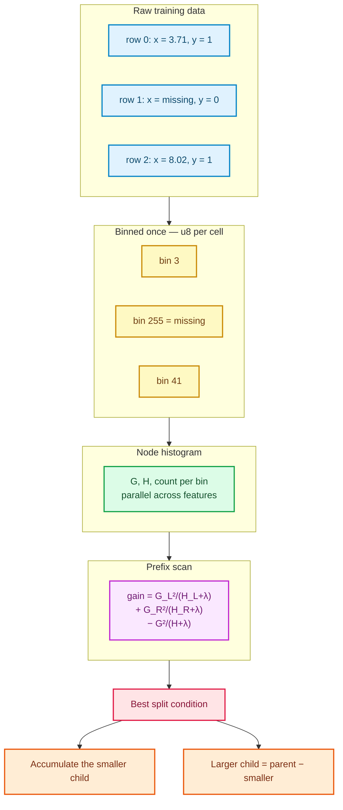

# Histogram gradient boosting: bins, histograms and leaves grown on the smaller child

[Chapter 47](./ch47-gradient-boosting.html) taught the boosting loop: fit a small tree to the
negative gradient of the loss, replace each leaf with a Newton step, shrink the tree and add it to
the running score. Its split finder, inherited from the exact CART implementation in
`sciencekit_tree`, pays a steep price at every node: it sorts each candidate feature again, so one
tree costs roughly $O(\text{number\_of\_nodes} \times \text{number\_of\_features} \times n \log n)$.

For a few thousand rows that is fine. For a few hundred thousand it is not, and it also gets in the
way of two things tabular data needs: **missing values** and **categorical columns**. This chapter
follows the implementation in `crates/sciencekit_ensemble/src/histogram_boosting/` that solves all
three problems at once — the LightGBM recipe: bin every feature once, search splits with
**histograms**, grow the tree **leaf-wise**, and represent categorical partitions with a bit mask.

---

## 1. The idea in one sentence

If a numeric feature is compressed to at most 255 bins, then a split decision only needs the sums of
gradients, Hessians and row counts in each bin — and those sums can be shared between a parent and
its children instead of being recomputed.

Two consequences follow immediately:

1. Split search becomes **linear in the number of bins**, not in the number of rows.
2. A node's histogram is cheap to update: accumulate the smaller child directly and **subtract** it
   from the parent to obtain the larger child.



---

## 2. Binning a column from zero

A **bin** is just a small integer identifier. Instead of remembering `3.71`, the model remembers
"bin 3". Binning is built in `binning/edges.rs` by `SKNumericBinning::derive`:

1. Collect the finite values of a column. `NaN` is the missing marker and is skipped here.
2. If the column holds more than 200 000 values, keep every `k`-th value so the sample stays
   deterministic. This is **quantile sketching in its simplest honest form**: the sample is fixed by
   position, never by a random draw, so two fits on the same column derive the same edges.
3. Sort the sample and pick `maximum_bins - 1` equally spaced quantile positions as interior edges,
   dropping duplicates.
4. `bin(value)` is a binary search (`partition_point`) over the edges. A `NaN` returns the reserved
   `missing_bin`, which is always `maximum_bins`.

The contract is deliberately small and testable. `hist_binning_derives_at_most_maximum_bins` checks
that 1 000 distinct values with `maximum_bins = 16` produce at most 16 bins and preserve order.
`hist_binning_routes_missing_to_dedicated_bin` checks that `NaN` never collides with an observed
value, and `hist_binning_is_deterministic` derives two binnings from 10 000 values and compares the
edges exactly.

`SKBinnedDataset` in `binning/dataset.rs` applies this per feature and stores the result
**column-major**: feature `f` owns one contiguous block of `number_of_rows` `u8` cells. Column-major
storage is the key to the next section — a histogram over a node's rows walks one compact block per
feature, which parallelizes cleanly across features.

Categorical features take a different branch. `SKFeatureBinning::categorical` records the observed
integer codes in ascending order, truncates them to `maximum_bins - 1` (leaving room for an unknown
category bin), and maps each code to its position. A code never seen during fit maps to
`unknown_bin = categories.len()`. Because the mapping stores **membership**, not an ordinal
distance, category `30` is not "bigger" than category `10`.

Sparse inputs are binned from their stored entries plus the implicit observed zero. The absent
coordinates are never materialized as a dense row; `hist_dataset_does_not_densify_sparse_input`
builds the same logical design densely and as CSR and compares the resulting bin vectors and edges.

---

## 3. Histograms, gain and the prefix scan

`histogram/accumulate.rs` turns the binned dataset into a **node histogram**. For every feature it
keeps three vectors indexed by bin:

- `gradient_sums[bin]` — the sum of negative gradients `−g`;
- `hessian_sums[bin]` — the sum of second derivatives `h`;
- `counts[bin]` — the number of node rows in that bin.

`sk_accumulate_histogram` maps each feature to its own rayon task and walks the node's row indices
once. `hist_accumulate_sums_gradients_and_hessians_per_bin` checks a four-row hand computation: one
row per bin, gradient sums `1, 2, 3, 4`, total gradient `10`. `hist_accumulate_respects_the_row_subset`
then accumulates only rows `{1, 3}` and verifies that the totals follow the subset, not the whole
table.

The split objective is the **Newton gain** already used by Chapter 47's leaf values:

$$
\text{gain} = \frac{G_L^2}{H_L + \lambda} + \frac{G_R^2}{H_R + \lambda} - \frac{G^2}{H + \lambda}.
$$

`sk_split_gain` in `histogram/gain.rs` is that formula. Because the bins are ordered by value, a
single left-to-right scan can maintain prefix `G`, `H` and count and evaluate every boundary. Each
candidate is rejected when either side has fewer than `minimum_samples_leaf` rows or when its gain is
not strictly positive. `hist_gain_matches_hand_computed_split` uses gradients `1, 1, -1, -1` and unit
Hessians to show that boundary 1 wins with gain `4`. `hist_gain_applies_l2_regularization` checks the
$\lambda$ term, and `hist_gain_rejects_splits_below_minimum_samples_leaf` shows that raising the minimum to
three rows removes every boundary.

---

## 4. Subtracting a parent histogram

The naive way to split a node is to accumulate both children from scratch. That repeats work on
every row. The histogram variant instead accumulates the **smaller** child and derives the larger one
as `parent − smaller`: gradients, Hessians and counts all subtract cell by cell.

`sk_subtract_histogram` in `histogram/subtract.rs` performs that subtraction.
`hist_subtract_equals_direct_accumulation` computes the same larger child twice — once by direct
accumulation and once by subtraction — and checks every bin's counts, gradient sums and Hessian sums
within `1e-12`. This is the test that keeps the bookkeeping honest: subtraction is an optimization
only if it produces the same numbers.

---

## 5. Leaf-wise growth instead of depth-first growth

Exact CART grows depth-first: split the left child, then its left child, and so on. Histogram
boosting grows **leaf-wise**: every leaf with a valid split becomes a candidate in a priority list,
and the leaf with the best gain splits next. This is `growth/leaf_wise.rs`.

The algorithm is short enough to follow:

1. Accumulate the root histogram and its best candidate split; the root starts as a pending leaf.
2. Pick the pending leaf whose **own** best candidate gain is largest. Ties resolve by lower node
   index, so the result does not depend on iteration order.
3. For every leaf that is created, scan the selected features. Feature subsampling
   (`maximum_features`) is seeded from `random_seed` and the node index, and the sampled indices are
   sorted so the scan order is stable. The resulting candidate travels with the leaf, so the
   priority list never ranks a child by the gain that produced it.
4. If no split is valid, the leaf keeps its Newton value.
5. Otherwise partition rows by the split condition, accumulate the smaller child, subtract the larger
   child, store both children as leaves and push them onto the pending list.
6. Stop when the number of leaves reaches `maximum_leaf_nodes` or no pending leaf splits.

The tree itself is a flat array in `growth/tree.rs`. `SKHistogramNode<F>` stores either a leaf value
or a split condition plus the indices of its two children. `SKHistogramTree::leaf_value_for` walks
that array with a closure that returns the bin of one feature — exactly the shape prediction needs.

`hist_growth_splits_the_highest_gain_leaf` grows the four-row example into three nodes: a root with
split `maximum_bin = 1` and leaf values `+1` and `−1`, with a normalized importance of `1.0` on the
only used feature. `hist_growth_splits_the_leaf_with_the_largest_own_gain` is the ordering guard: the
root splits after bin 3, its left child can still improve by `0.75` and its right child by `2.0`, so
with a budget of three leaves the right child must be the one split. `hist_growth_respects_the_maximum_leaf_budget`
grows 16 alternating rows with a budget of three leaves and checks that the tree stops at exactly
three leaves and five nodes. `hist_growth_creates_a_leaf_node_without_a_split` pins down the leaf
constructor.

---

## 6. Categorical splits are membership masks, not thresholds

A numeric split asks $\text{bin} \le \text{maximum\_bin}$. A categorical split cannot: `{10, 30}` versus `{20}` is
not an interval. `sk_scan_categorical_feature` in `histogram/categorical.rs` therefore:

1. Sorts the observed category bins by their gradient-to-Hessian ratio $G / (H + \lambda)$.
2. Scans prefix partitions of that ordering, evaluating the same gain formula.
3. Stores the winning left set as a `BitVec<u8, Lsb0>` with one bit per observed category bin.
4. Sends the unknown-category bin to the right, a documented direction that never panics.

`hist_categorical_partitions_categories_by_gradient_ratio` builds gradients $3, -4, 3$ over
categories $\{10, 20, 30\}$ and asserts that the winning mask has bits 0 and 2 set, bit 1 clear, and
gain $98/3$. `hist_categorical_respects_minimum_samples_leaf` shows that requiring two rows per side
leaves only three rows and removes every partition.

At prediction time `SKHistogramTree` reads the membership bit for the query's category bin. A query
category absent from the fitted list maps to `unknown_bin`, falls outside the mask and follows the
documented right direction. `hist_growth_routes_an_unknown_category_away_from_the_left_mask` builds
the minimal categorical tree by hand and checks both sides of that traversal: the unknown bin and a
masked-out observed category reach the right leaf, while a masked-in category reaches the left one.

---

## 7. Missing values learn a direction

The dedicated missing bin is included in every numeric scan, in **both** possible directions. For a
given boundary the scan evaluates "missing rows go left" and "missing rows go right", keeps the
larger gain and stores the winner as `default_left`. Prediction checks the bin first: a bin equal to
`missing_bin` follows `default_left`; every other bin follows the ordinary $\text{bin} \le \text{maximum\_bin}$ rule.

`hist_missing_learns_the_left_direction` and `hist_missing_learns_the_right_direction` construct
gradients that make each direction strictly better and then assert that a missing query reaches the
same leaf as the corresponding side. `hist_missing_without_missing_rows_uses_deterministic_direction`
shows the tie-breaking rule: with no missing rows both directions have the same gain, the scan keeps
the first candidate, and the learned direction is deterministically "right" (`default_left = false`).

---

## 8. Boosting on top of the same loss contract

The booster does not re-implement losses. `stage.rs` asks the existing `SKGradientLoss` trait for
`negative_gradient` and `hessian`, grows a histogram tree, then adds $\text{learning\_rate} \times \operatorname{tree}(x)$ to
every row's raw score. `hist_stage_applies_a_hand_computed_newton_update` fits a single stage to
targets $0, 0, 1, 1$ with squared error: the initial prediction is $0.5$, the two leaves are
$-0.5$ and $+0.5$, and with learning rate $0.1$ the raw scores become $0.45, 0.45, 0.55, 0.55$.

The scalar loop in `scalar_loop.rs` and the multiclass loop in `multiclass_loop.rs` reuse the
existing gradient-boosting pieces:

- `sk_initialize_scalar_scores` / `sk_initialize_multiclass_scores` for the constant start;
- `SKEarlyStoppingMonitor` for patience and best-stage restoration;
- `sk_split_regression_validation_rows` / `sk_split_classification_validation_rows` for the seeded
  held-out split;
- `sk_select_stage_rows` for without-replacement row subsampling.

Every stage recomputes the negative gradients and Hessians from the **current** raw scores, for both
the scalar and the multiclass loops; reusing the initial scores would refit the same trees forever.
`hist_multiclass_refreshes_gradients_between_stages` compares the first two stage trees of every class
and fails if the second stage simply repeats the first. The same `subsample` fraction is drawn per
stage and per class before growth, and `hist_multiclass_applies_row_subsampling` checks that the root
of a `0.5`-subsampled multiclass tree holds fewer than all training rows.

Early stopping is on by default with patience `10`, exactly as the specification's default scenario
requires. `hist_early_stop_reports_the_fitted_iteration_count` fits a constant target and shows the
model keeps only the single best stage even though 20 were allowed.
`hist_early_stop_disabled_fits_every_iteration` checks that `without_early_stopping` fits all seven
requested stages, `hist_early_stop_keeps_every_stage_when_no_validation_split_is_possible` covers the
three-row, three-class case where no stratified hold-out exists and all five stages must survive, and
`hist_early_stop_is_seed_deterministic` fits the same seeded configuration twice and compares the
reported stage count.

Prediction bins each raw query row on the fly through the stored `SKFeatureBinning`, so no binned
matrix has to be stored or rebuilt. Dense rows read their cells; CSR rows read only stored entries
and treat absent coordinates as the observed zero. Both go through the same model code.

---

## 9. The public surface

| Object | Role |
|---|---|
| `SKHistGradientBoostingClassifier<F>` / `SKHistGradientBoostingRegressor<F>` | Configured estimators, built only through their builders |
| `SKHistGradientBoostingClassifierBuilder<F>` / `SKHistGradientBoostingRegressorBuilder<F>` | Mandatory builders with `backend(SKBackendKind)` defaulting to `Faer` and `execution_mode` defaulting to `Automatic` |
| `...ClassifierModel<F>` / `...RegressorModel<F>` | Fitted models exposing stage trees, initial predictions, learning rate, bin edges, categories, feature importances and fitted iteration count |
| `SKHistGradientBoostingRegressionLoss` | `SquaredError` (default) or `AbsoluteError` |
| `SKNumericBinning<F>`, `SKFeatureBinning<F>`, `SKBinnedDataset<F>` | Quantile edges, category mapping and the column-major `u8` store |
| `SKHistogramTree<F>`, `SKHistogramNode<F>` | Flat histogram tree and binned traversal |
| `SKHistogramSplit`, `SKHistogramSplitCandidate<F>` | Numeric and categorical split conditions with their gain |
| `sk_accumulate_histogram`, `sk_split_gain`, `sk_scan_numeric_feature`, `sk_scan_categorical_feature`, `sk_subtract_histogram`, `sk_grow_histogram_tree` | Free-scope building blocks used by the stages |

Defaults follow the specification: 100 iterations, 255 bins, 31 leaves, at least 20 samples per
leaf, no categorical features, early stopping with 10 non-improving iterations, `Faer`, `Automatic`.

---

## 10. Decisions and roads not taken

- **Column-major instead of row-major.** Row-major would make row-wise prediction slightly more
  direct, but histogram accumulation visits one feature at a time across a node's rows. Column-major
  wins for the hot loop; prediction bins a single row on the fly and does not need a stored matrix.
- **Recompute exact CART?** No. The exact splitter in `sciencekit_tree` remains available for users
  who need thresholds on raw values. The histogram booster reuses the tree conventions but has its own
  `u8`-bin node type, because categorical masks and missing directions cannot be expressed by a single
  numeric threshold.
- **One `u8` per cell, not per-feature dynamic lengths.** A shared stride of `maximum_bins + 1` keeps
  indexing trivial and the storage compact. A feature with fewer distinct values simply leaves empty
  bins, which the scan rejects through the sample-count constraint.
- **Deterministic sampling, not random quantile sketches.** The column sample is a fixed stride and
  the row subsample is a seeded draw without replacement, so repeated fits and different thread counts
  produce identical trees. `hist_determinism_repeated_fits_agree`,
  `hist_determinism_is_thread_count_invariant` and `hist_determinism_concurrent_prediction_agrees`
  stand guard over that promise.
- **`memmap2` streaming, monotonic/interaction constraints and export are deliberately deferred.**
  The in-memory binned store is the first implementation; a future memory-mapped store replaces it
  behind the same binning interface. `docs/PRD.md` §8.8 records the deferral.

---

## 11. Walking the companion tests

The executable contract lives beside the implementation, in `*_tests.rs` modules:

- `binning/binning_tests.rs` — `hist_binning_derives_at_most_maximum_bins`,
  `hist_binning_routes_missing_to_dedicated_bin`, `hist_binning_is_deterministic`.
- `binning/dataset_tests.rs` — `hist_dataset_stores_columns_with_u8_bins`,
  `hist_dataset_maps_categories_and_unknown_bin`,
  `hist_dataset_rejects_out_of_range_maximum_bins`, `hist_dataset_does_not_densify_sparse_input`.
- `histogram/accumulate_tests.rs`, `gain_tests.rs`, `subtract_tests.rs`, `categorical_tests.rs` — the
  hand-computed sums, the gain formula, subtraction equivalence and the bit-mask partition.
- `growth/growth_tests.rs`, `missing_tests.rs` — the hand-computed growth sequence, the leaf budget
  and both learned missing directions.
- `classifier_tests.rs`, `regressor_tests.rs`, `early_stopping_tests.rs`,
  `multiclass_loop_tests.rs` — defaults, binary, multiclass, squared/absolute error, regularization,
  the fitted-iteration count, refreshed multiclass gradients and per-stage subsampling.
- `representation_tests.rs`, `validation_tests.rs`, `determinism_tests.rs` — dense/CSR parity, every
  documented error, repeated-fit and thread-count determinism, concurrent prediction and `Send + Sync`.
- `acceptance_tests/{tiny_tests,large_tests,metric_tests}.rs` — tiny designs, categorical and missing
  values, 50 000-row binary/multiclass/regression fits, and metric production through
  `sciencekit_metrics` (`hist_acceptance_large_regression`,
  `hist_acceptance_produces_classification_and_regression_metrics`).

Run them with:

```sh
cargo test -p sciencekit_ensemble hist_
```
