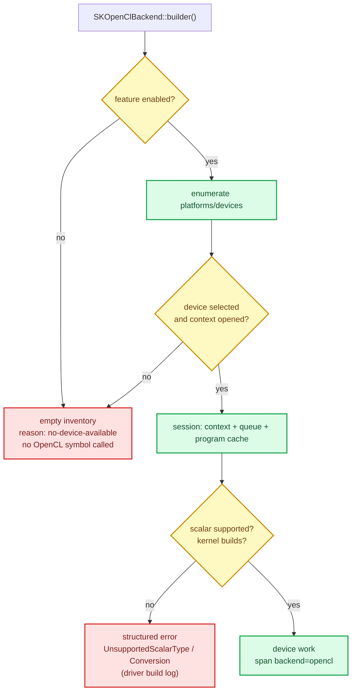

# OpenCL backend: command queues, kernels and honest device work

The [GPU compute contracts chapter](./ch38-gpu-compute-contracts.html) built a promise:
`SKDeviceInfo`, `SKDeviceCapabilities`, `SKGpuKernel`, `SKDeviceBuffer` and
`SKFallbackReason` describe *what* a device backend must look like, without any vendor
runtime. This chapter delivers the first backend that keeps that promise on real hardware —
OpenCL 3.0, reached through an ICD loader, behind the `opencl` feature of `sciencekit_gpu`
and re-exported by the `sciencekit_gpu_opencl` package through its `gpu-opencl` feature.

Nothing here invents a second device vocabulary. The types this chapter describes *are* the
contract types; the backend only adds the machinery that turns them into work on a device.

```mermaid
flowchart LR
    accTitle: One OpenCL operation from host array to verified result
    accDescr: A host matrix is copied into a device buffer, the program is compiled once and cached, the kernel is enqueued on the in-order command queue with its buffer arguments, the device executes it, and the output buffer is copied back to the host. The backend records the backend kind, the operation, the device and the bytes moved on the observability span.
    H["host array<br/>ndarray view"] -->|"upload (copy)"| B["device buffer<br/>cl_mem"]
    S["embedded OpenCL C source"] -->|"compile once,<br/>cache per device"| P["program + kernel"]
    B --> Q["command queue<br/>(in-order)"]
    P --> Q
    Q -->|"enqueue kernel"| D["device execution"]
    D --> O["output buffer"]
    O -->|"download (copy)"| R["host result<br/>ndarray"]
    Q -.->|"bytes moved"| T["span: backend=opencl,<br/>operation, device_index,<br/>transfer_bytes"]
    classDef host fill:#dbeafe,stroke:#2563eb,stroke-width:2px,color:#1e3a8a
    classDef device fill:#dcfce7,stroke:#16a34a,stroke-width:2px,color:#14532d
    classDef plan fill:#fef9c3,stroke:#ca8a04,stroke-width:2px,color:#713f12
    classDef trace fill:#f3e8ff,stroke:#9333ea,stroke-width:2px,color:#581c87
    class H,R host
    class B,D,O device
    class S,P,Q plan
    class T trace
```

## 1. From zero: what a GPU actually asks of you

A graphics card is not a faster CPU that you call like a function. To make it compute you
need five objects, and every OpenCL program is a story of moving data between them:

1. **A platform and a device.** The ICD loader (`libOpenCL.so.1` on Linux) is a small
   dispatcher that finds vendor drivers registered under `/etc/OpenCL/vendors`. Each driver
   reports **platforms**, and each platform reports **devices** — an NVIDIA GPU, an AMD GPU,
   an Intel integrated chip, even a CPU runtime. A *device* is what actually executes
   kernels; the crate describes it with `SKDeviceInfo` and `SKDeviceCapabilities`.
2. **A context.** A context is the device's little universe: buffers and programs created
   in it can only be used with that same device.
3. **A command queue.** Work does not run when you "call" it; you *enqueue* commands —
   "write this buffer", "run this kernel", "read that buffer" — and the queue delivers them
   to the device. The backend creates an **in-order** queue, which is the simplest possible
   contract: commands complete in the order they were enqueued. That is why the code does
   not need explicit event waits before reading a result.
4. **A buffer.** Device memory is separate from your process memory. A `cl_mem` allocation
   holds bytes on the card; to fill it you **copy** host data in (upload), and to see a
   result you **copy** it back (download). Those two copies are the cost that no kernel can
   hide, which is why the backend counts them.
5. **A program and a kernel.** OpenCL C source is compiled **at runtime** on the target
   device by the vendor's compiler, producing a *program*; a named function inside it is a
   *kernel*. The backend embeds its sources in the library, compiles each one once per
   device and caches the result, so a repeated dispatch pays no compile cost.

A kernel executes over a **work range**: one *work item* per output element. The pairwise
kernel uses a two-dimensional range (one item per output pair); GEMM uses a two-dimensional
range grouped into 16 × 16 tiles whose inputs are staged in **local memory** (memory shared
by the work items of one group, much faster than global memory).

## 2. The decisions, and the roads not taken

1. **`opencl3` 0.12.0, pinned exactly.** The spike compared the two maintained crates on this
   machine (RTX 3070 Ti Laptop GPU, `clinfo` reporting `Platform #0: NVIDIA CUDA` and
   `libOpenCL.so.1`, with no development symlink and no CL headers):
   - `ocl` 0.19.7 failed at link time with `cannot find -lOpenCL`: it links the development
     symlink, which a runtime-only install does not have.
   - `opencl3` 0.12.4 (the latest) failed the workspace MSRV: it uses `Vec::len` in a const
     context, which Rust 1.85 does not accept.
   - `opencl3` **0.12.0** compiles on Rust 1.85 and resolves to `cl3` 0.13.2, whose dynamic
     loader opens `libOpenCL.so.1` at runtime. The spike kernel read back
     `[2.0, 4.0, 6.0, 8.0]` from the actual GPU.

   *Road not taken:* linking a vendor SDK at build time. It would make the default build
   require a GPU toolchain, break CI on machines without one, and contradict the contract
   crate's promise of a runtime-free default.
2. **The implementation lives in `sciencekit_gpu`, behind `opencl`.** The contract traits
   `SKComputeBackend` and `SKDeviceDiscovery` are defined there; a crate implementing them
   cannot also be a dependency of `sciencekit_gpu` — that is a package cycle. So the planned
   vendor-facing package `sciencekit_gpu_opencl` exists as a facade whose `gpu-opencl`
   feature enables `sciencekit_gpu/opencl` and re-exports the backend. It exposes no second
   contract: every type it exports *is* the `sciencekit_gpu` type.
3. **The kernel catalogue is carried, not partially advertised.** Every enumerated device
   advertises all four kernels (`PairwiseDistance`, `Gemm`, `Elementwise`, `TreePredict`)
   because the backend implements all four. A device that cannot run one of them is a bug,
   not a capability gap, and the planner's `KernelNotSupported` reason remains reserved for
   future backends.
4. **The safe path copies; the mapped path is not claimed.** Mapped memory is reported in
   capabilities (`host_unified_memory`), but the backend's declared transfer policy is
   `SKDeviceTransferPolicy::Explicit` and every transfer is a visible copy with accounting.
   *Road not taken:* mapping host memory into the device address space, which is faster on
   unified-memory parts but makes lifetimes and aliasing a per-vendor negotiation.
5. **Kernels are precision-generic sources, compiled per scalar type.** The embedded source
   writes `SK_REAL`, replaced by `float` or `double` before compilation. One kernel file
   serves both precisions; f64 support is still gated by the device's reported
   `double_fp_config`, and a device without it returns `UnsupportedScalarType` instead of
   silently computing in f32. The session caches each compiled program under a key carrying
   **both the kernel name and the scalar type**, so an f32 dispatch can never hand a later
   f64 dispatch the wrong program.
6. **The fallback backend always exists.** `SKOpenClBackend` is compiled whether the feature
   is on or off. With the feature off it calls no OpenCL symbol, `discover_devices` returns
   an empty inventory and `fallback_reason()` returns
   `Some(SKFallbackReason::NoDeviceAvailable)`. A call site can therefore be written once
   and still report the truth on a CPU-only build.

## 3. The public objects

| Object | Where | What it is |
|---|---|---|
| `SKOpenClBackend` | `crates/sciencekit_gpu/src/opencl/backend/` | The backend. Built only through `SKOpenClBackend::builder()`. Implements `SKDeviceDiscovery` and `SKComputeBackend<F>`. |
| `SKOpenClBackendBuilder` | `backend/builder.rs` | `device_index(usize)` pins one enumerated device, `transfer_policy(...)` chooses the policy, `build()` is strict, `build_or_fallback()` records the reason instead of failing. |
| `SKOpenClDistanceMetric` | `opencl/kernels/pairwise.rs` | `SquaredEuclidean`, `Euclidean`, `Manhattan`, `Chebyshev`. |
| `SKOpenClBuffer<F>` | `opencl/buffer/resident.rs` | A validated, device-resident matrix: shape, scalar type, device index and element count. |
| `SKOpenClTransferReport` | `backend/implementation.rs` | `upload_bytes`, `download_bytes`, `kernel_bytes` and `total_bytes()`. |
| `sk_opencl_devices` | `opencl/device.rs` | Stable enumeration of the ICD loader's devices. |
| `sk_register_opencl_device_inventory` | `opencl/device.rs` | Registers the enumeration process-wide, so `sk_resolve_operation_backend(OpenCl)` selects a device. |
| `SK_OPENCL_TREE_NODE_COLUMNS` | `opencl/kernels/tree.rs` | The six-column node layout the tree kernel documents. |

The typed operations on the backend are `upload_resident`, `download_resident`,
`pairwise_distances`, `gemm`, `transform`, `combine` and `predict_trees`. The shared contract
methods (`upload`, `download`, `dispatch`) are also implemented: they accept and return the
contract's staged `SKDeviceBuffer<F>`, and therefore perform a genuine device round-trip (the
staged buffer carries no runtime handle). Callers that can hold a `SKOpenClBuffer<F>` use the
resident path and avoid re-uploading.

## 4. How the truth is kept: fallback and observability

The API makes the decision impossible to ignore:

- `build()` returns `Err(SKError::DeviceUnavailable { backend: "opencl", reason })` when no
  device can serve the request.
- `build_or_fallback()` returns a backend whose `is_available()` is `false`,
  `availability()` returns that same structured error, `fallback_reason()` returns
  `Some(SKFallbackReason::NoDeviceAvailable)` and every operation returns
  `DeviceUnavailable`. This is the shape planning wants: it can always hold a backend value
  and read the reason, instead of matching on a constructor failure.

Every public operation opens a span through `SKOpenClBackend::operation_span(operation)`.
An operation with an open session records `backend = opencl`, the operation name and — once
known — `device_index` and `transfer_bytes`: a trace shows *which* device ran the kernel and
*how much* data crossed the bus. An operation on a backend without a device never claims
device work: it records the host fallback kind (`faer`) and the `fallback_reason`
(`no-device-available`), exactly as `sk_resolve_operation_backend` does, and leaves the
device index and byte count unset. The tests
`a_kernel_operation_records_backend_device_and_bytes` and
`an_unavailable_operation_records_the_host_fallback_and_reason` assert both halves.

## 5. The kernels, one by one

- **Pairwise distance** (`kernels/pairwise.rs`): work item `(column, row)` computes
  `output[row, column]` from one left row and one right column. The metric is a kernel
  argument, so one compiled program serves all four metrics. Euclidean takes the square root
  inside the kernel; Chebyshev folds with `fmax`. Shape validation happens on the host
  before any buffer is touched.
- **GEMM** (`kernels/gemm.rs`): a classic tiled kernel. Each 16 × 16 work group loads a tile
  of `left` and a tile of `right` into `__local` memory, synchronizes with
  `barrier(CLK_LOCAL_MEM_FENCE)`, and accumulates. Global sizes are rounded **up** to whole
  tiles, and every read and the final write are bounds-checked — which is what makes
  unaligned sizes like 17 × 23 · 23 × 19 correct.
- **Elementwise** (`kernels/elementwise.rs`): `sk_elementwise_transform` computes
  `input · factor + offset`; `sk_elementwise_combine` computes `left + right`. One work item
  per element.
- **Tree prediction** (`kernels/tree.rs`): one work item walks one feature row from the root
  to a leaf. The tree is a dense matrix with six columns per node — feature index,
  threshold, left child, right child, leaf value, leaf flag — documented by
  `SK_OPENCL_TREE_NODE_COLUMNS`. The walk is bounded by a maximum depth so a malformed tree
  cannot hang the device.

A kernel failure is never silent: `create_kernel` compiles through the session's program
cache, and `session::compile_program` turns a failed build into
`SKError::Conversion("OpenCL program build failed with code ...: <driver build log>")`. The
test `a_broken_program_reports_the_build_log` asserts that the driver's diagnostic text is
part of the error.

## 6. Why transfers and memory checks matter

A GPU is not automatically faster. The cost of an operation is
`upload + kernel + download`; for small matrices the copies dominate, and the correct answer
is to stay on the CPU. The backend does not pretend otherwise: it makes the copies explicit,
reports them through `transfer_report()`, and never claims a speedup. This is also why the
resident path exists — upload once, dispatch many times — and why `upload`/`download` in the
contract path are documented as the convenient, copying path.

Two guards keep failure structured rather than fatal:

- `SKOpenClAllocation::allocate` compares the requested byte count with the device's reported
  memory and returns `DeviceUnavailable` when the request cannot fit (some drivers otherwise
  over-commit virtual memory silently).
- `write_from_host` rejects a payload larger than the allocation with `ShapeMismatch`.
  Together with scalar-type validation these are the buffer scenarios of the spec.

## 7. The companion tests, by name

The tests live beside the code and are the executable source of truth. On a host with an
OpenCL device they run for real and print the device line; on a host without one they print a
skip line — but they never fake a device.

- `opencl::device::device_tests::enumeration_is_stable_and_describes_opencl_devices` —
  enumeration is stable, every entry is an OpenCL device, and the feature-off build
  enumerates nothing.
- `...::an_empty_inventory_has_no_device_to_select` — an empty inventory reports
  `DeviceUnavailable`, never a guessed device.
- `...::selection_is_deterministic_and_honours_the_device_index` — repeated selection agrees;
  an impossible index is rejected.
- `...::registering_the_inventory_resolves_opencl_to_a_device` — the shared resolver returns
  `OpenCl` with no fallback reason once the inventory is registered.
- `opencl::buffer::buffer_tests::buffers_round_trip_without_loss` — f32 and f64 matrices come
  back bit-for-bit.
- `...::an_oversized_allocation_reports_a_structured_error` — a 32 TiB request is rejected
  against the device's memory and an oversized payload is rejected against the capacity.
- `opencl::kernels::kernels_tests::pairwise_metrics_match_the_cpu_reference` — all four
  metrics against a CPU reference on a 13 × 11 / 17 × 11 input.
- `...::large_pairwise_matches_the_cpu_reference` — 257 rows against 129 rows.
- `...::single_precision_pairwise_matches_within_tolerance` — the f32 tolerance (1e-3).
- `...::one_backend_serves_both_precisions_of_the_same_kernel` — an f32 dispatch followed by
  an f64 dispatch of the same kernel on one backend still matches the CPU.
- `...::programs_are_cached_once_per_scalar_type` — the same program is reused, and each
  precision owns a separate cache entry.
- `...::gemm_matches_the_cpu_reference` — 17 × 23 × 19, 64 × 96 × 32 and 129 × 47 × 65.
- `...::elementwise_kernels_match_the_cpu_reference` — affine transform and combination.
- `...::tree_prediction_matches_the_cpu_reference` — a hand-built five-row tree, including a
  tie on the threshold.
- `...::a_broken_program_reports_the_build_log` — a deliberately malformed source surfaces
  the compiler diagnostic.
- `opencl::backend::fallback_tests::a_backend_without_a_device_records_the_fallback_reason`,
  `...::fallback_operations_report_structured_errors` and `...::the_strict_builder_reports_the_reason` —
  the fallback in both configurations.
- `...::a_real_device_serves_the_contract_surface` — upload, download and a GEMM dispatch
  through the shared contract buffers.
- `opencl::backend::concurrency_tests::concurrent_pairwise_dispatches_agree` and
  `...::concurrent_transfers_agree` — eight threads over one shared backend.
- `opencl::backend::observability_tests::a_kernel_operation_records_backend_device_and_bytes` —
  the span records `opencl`, the operation, the device index and a positive byte count.
- `opencl::backend::fallback_tests::an_unavailable_operation_records_the_host_fallback_and_reason` —
  a failed device attempt records the host fallback and `no-device-available`, never OpenCL
  device work it did not perform.
- `sciencekit_gpu_opencl::lib_tests::the_reexported_backend_runs_a_real_kernel` — the facade
  package's feature wiring drives a real GEMM.

## 8. Maintaining this chapter

When a kernel is added, extend `SKGpuKernel`, add its embedded source, add a typed operation
and a CPU-parity test — and update this chapter's kernel list and the test walk-through. When
a new device backend arrives (CUDA, ROCm), it plugs into the same contracts and the same span
fields; only the vendor runtime changes. Keep the rule from the contracts chapter intact: a
backend either does the work on a device or reports, in a structured and observable way, why
the CPU is doing it instead.
