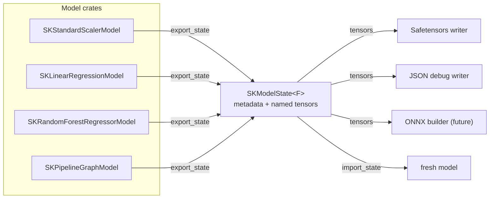
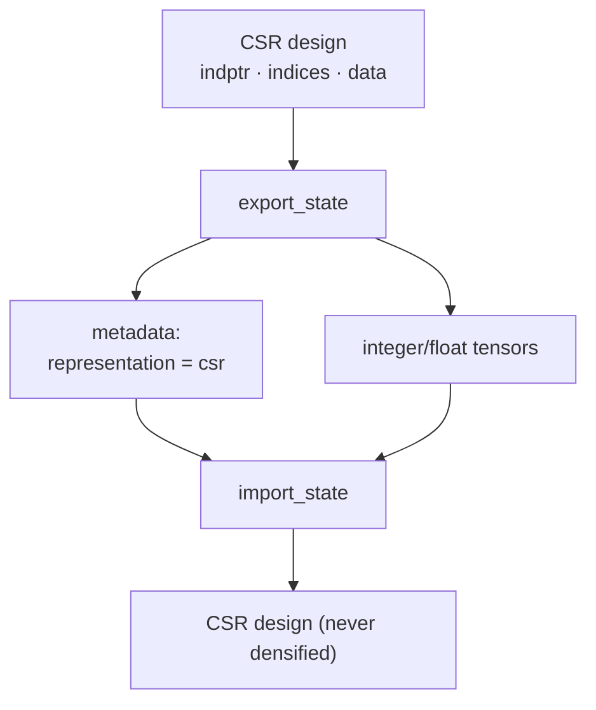

# One model state for every fitted model

This chapter explains how `sciencekit` gives every fitted model the same
export/import surface — one neutral schema that Safetensors, the JSON debug
reader, ONNX and the language bindings can all consume without knowing a single
estimator. It is written for a reader who has never used Rust or a numerical
library, and every claim is grounded in the code and the companion tests.

## Why one schema instead of one serializer per model

Imagine a library where every estimator invents its own file format. Saving a
scaler requires one reader, saving a forest another, saving a pipeline a third,
and every new estimator multiplies the formats. A format crate would have to
know the private fields of every model, which breaks encapsulation, and each
model would drift from the others.

The library therefore defines a **format-agnostic contract** in
`sciencekit_common::interop`:

- `SKExportable<F>` — a fitted model describes its learned state.
- `SKImportable<F>` — a model rebuilds itself from that state.
- `SKModelState<F>` — the state itself: metadata plus a deterministic map of
  named tensors.
- `SKModelMetadata` — estimator name, format version, scalar dtype, feature
  count, optional class labels and typed hyperparameters.
- `SKTensor<F>` — a named tensor with a data type, a shape and an owned payload
  (`Floating`, `Integer` or `Boolean`).

A **format** crate (Safetensors, JSON) only walks `tensors()`; it never imports
an estimator. A **model** crate implements the two traits beside its model, so
private fields stay private. This is the single most important decision of the
change.



## Stable dotted names and versioning

Every tensor name is a dotted path: the first segment is a short scope and the
remaining segments name the learned field. Real examples from the code:

```text
standard_scaler.mean
standard_scaler.scale
minmax_scaler.minimum
one_hot.category_counts
linear.coefficients
ridge.coefficients
knn.training_dense
svm.dual_coefficients
tree.nodes.threshold
forest.tree.0.t.tree.nodes.value
gradient_boosting.stage.0.nodes.value
```

The names are a compatibility promise. Renaming a tensor, changing its shape or
changing its meaning requires bumping `SK_MODEL_FORMAT_VERSION` in
`crates/sciencekit_common/src/interop/shared.rs`. Every importer calls
`sk_validate_import_metadata` before reading a tensor, so a foreign estimator
name or a different version is rejected as `UnsupportedRepresentation`, never
half-imported. The shared round-trip helper `sk_assert_export_round_trip`
exports twice and refuses any state whose second export differs: export must be
read-only and deterministic.

## How a sparse model survives a round trip

A sparse training design must never be silently densified. The neighbor and SVM
helpers encode a CSR matrix as its `indptr`/`indices`/`data` triple and record
`training_representation = "csr"` (or `support_vector_representation`) in the
metadata. Import rebuilds a CSR matrix and asserts the representation. The test
`knn_regressor_keeps_a_sparse_design_sparse` in
`crates/sciencekit_neighbors/src/classifier/export_tests.rs` fits on CSR,
round-trips and checks `training_representation() == "csr"` before comparing
predictions.



## Metadata carries the configuration

A model must reconstruct not only its numbers but its behavior. Metadata carries
the estimator name, the format version, the scalar dtype, the feature count,
class labels in canonical index order, and typed hyperparameters through
`SKParameterValue` (bool, integer, float, string, list). Examples from the code:
the standard scaler records `with_mean`, `with_std`, `sample_count` and
`backend`; ridge records `rank`, `include_intercept` and `solver`; the random
forest records its OOB kind, score and scored-row count; logistic regression
records its penalty, solver, class-weight policy and multi-class strategy.

The resolved backend travels as its documented display name through
`sk_backend_parameter`, and an imported model reports the same
`SKBackendKind` in its observability spans. The tests assert exactly that, for
example `linear_regression_round_trips_coefficients_rank_and_backend`.

**A subtle trap: NaN.** Missing markers and imputation statistics legitimately
store `NaN`, and derived equality says `NaN != NaN`, which would make two
identical exports look different. The shared helper `sk_states_equal` treats two
NaNs as equal, and the imputer encodes a NaN missing marker as the string
`"nan"` in metadata.

## Where the code lives

Each model crate keeps the implementation beside the model, following the
repository's folder-module rule: a pure-dispatcher `mod.rs` declares
`mod export;` and the implementation lives in `export.rs`, with a
`*_tests.rs` companion at the end.

- `sciencekit_common::interop::shared` — the format version, scalar dtype
  mapping, tensor readers, backend and metadata readers.
- `sciencekit_common::interop::testing` — `sk_assert_export_round_trip`,
  `sk_assert_state_names` and `sk_states_equal`.
- `sciencekit_tree::export_helpers` — the node-array codec reused by trees,
  forests and gradient boosting.
- `sciencekit_neighbors::neighbors::export_helpers` and
  `sciencekit_svm::export_support` — the dense/CSR-preserving block codecs.
- `sciencekit_common::interop::nested` — `sk_embed_state` / `sk_extract_state`,
  reused by the composed imputer, the forests, gradient boosting and the typed
  pipeline to nest one model's whole state under a namespace.

## Walking the companion tests

Every family has a test that fits, exports, imports into a fresh model, and
compares predictions — never merely "export returned Ok".

- `standard_scaler_round_trips_predictions_and_backend`
  (`crates/sciencekit_preprocessing/src/standard_scaler/model/export_tests.rs`)
  fits three scalers with `SKBackendKind::MatrixMultiply`, round-trips each and
  asserts bit-identical `transform` output plus the preserved backend.
- `one_hot_encoder_round_trips_integer_category_codes`
  (`crates/sciencekit_preprocessing/src/one_hot_encoder/model/export_tests.rs`)
  proves integer category tables survive; the nominal test proves string label
  tables do.
- `simple_imputer_round_trips_the_composed_indicator`
  (`crates/sciencekit_impute/src/simple_imputer/model/export_tests.rs`) embeds
  the composed missing-indicator under a nested namespace and compares the
  stacked output.
- `ridge_round_trips_multi_alpha_solutions`
  (`crates/sciencekit_linear_model/src/ridge/model/export_tests.rs`) compares
  every coefficient row and both intercepts for a two-alpha fit.
- `logistic_regression_round_trips_probabilities` and
  `sgd_classifier_round_trips_classes_and_heads` compare calibrated and
  one-vs-rest outputs and the canonical class table.
- `knn_regressor_keeps_a_sparse_design_sparse` and
  `svc_round_trips_pairwise_support_vectors_and_classes` compare predictions
  after proving the representation and the class table survived.
- `random_forest_classifier_round_trips_members_and_oob` and
  `gradient_boosting_regressor_round_trips_stages` compare predictions across
  nested tree states.
- `histogram_regressor_round_trips_binning_and_missing_routing` compares the
  exported bin edges and predictions with NaN routing, while
  `histogram_classifier_round_trips_categorical_masks` checks the categorical
  table; `histogram_regressor_round_trips_a_sparse_design` proves a CSR design
  stays sparse.
- `kmeans_round_trips_centers_labels_and_backend`,
  `dbscan_round_trips_labels_and_nearest_core_assignment`,
  `pca_round_trips_components_mean_and_whitening`,
  `truncated_svd_round_trips_components_and_projection` and
  `isolation_forest_round_trips_trees_offset_and_scores` cover the remaining
  learned-state families.

## Coverage in this change

The retrofit lands family by family, each family in its own commit:

| Family | State |
|---|---|
| Scalers (`standard_scaler`, `minmax_scaler`, `robust_scaler`) | Implemented |
| One-hot encoders and polynomial features | Implemented |
| Simple imputer, missing indicator, KNN imputer | Implemented |
| Linear regression, ridge, lasso, elastic net, logistic regression, SGD | Implemented |
| K-nearest neighbours (dense and CSR) | Implemented |
| SVC, SVR, LinearSVC | Implemented |
| Decision trees, random forests, gradient boosting, bagging | Implemented |
| Histogram gradient boosting | Implemented (binning tables, categorical masks, missing routing) |
| Clustering (KMeans, MiniBatchKMeans, DBSCAN) | Implemented |
| Decomposition (PCA, TruncatedSVD, IncrementalPCA) | Implemented |
| Outlier detection (IsolationForest) | Implemented |
| Typed pipelines | Export implemented; import is unsupported by design |
| Grid-search and halving winners | Implemented (best model plus selection metadata) |

The workspace-wide coverage test in the umbrella crate asserts at compile time
that every fitted model type implements the contract, and at run time that the
shared format version is used and concurrent exports agree
(`concurrent_export_agrees_with_the_single_threaded_state`).

A typed pipeline exports its stages and final model but cannot reconstruct its
configured stage chain from a state — those are live estimator values, not data
— so import is deliberately not implemented there. The graph pipeline has the
same limitation through its type-erased boxes. This is the documented
"reconstructible" boundary of the contract.

## Roads not taken

- **Derive macros.** A `#[derive(SKExportable)]` would remove boilerplate, but
  it would also freeze private field names as public tensor names. The explicit
  code is the documentation of the format.
- **One serializer per model.** Rejected for the reasons in the first section.
- **Densifying sparse inputs.** Rejected: a sparse model must stay sparse, and
  the CSR triple keeps it so.
- **Silently accepting unknown versions.** Rejected: import fails loudly with
  `UnsupportedRepresentation` and never builds a partial model.
