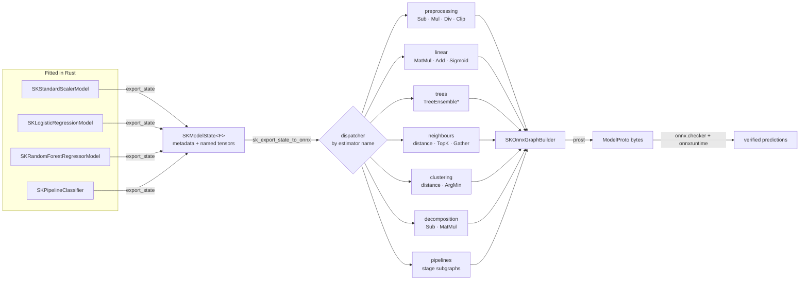

# ONNX export: turning a fitted model into a portable graph

This chapter explains how `sciencekit` exports fitted models to **ONNX**, the
Open Neural Network Exchange format that Python, C++, Java, JavaScript, mobile
and edge runtimes all read. It assumes no prior Rust knowledge, no numerical
computing background and no ONNX experience. Every claim below points at real
code in `crates/sciencekit_onnx` and at a real companion test.

## The problem: a model is useful only where it can run

`sciencekit` trains models in Rust. A team often wants to *serve* one of those
models somewhere else: a Python service, a browser, a phone, a C++ trading
engine. Copying the Rust binary is not an option there. The usual answer is a
neutral **inference format** — a file that any runtime can load.

ONNX is that format. It is **not** a training format and not a serialization of
a particular library's structs. It is a description of a computation: "read a
matrix, multiply it by these numbers, add those numbers, apply a sigmoid, emit
the result". A runtime reads the description and executes it.

### What an ONNX file actually contains

Think of an ONNX model as a recipe card with four sections:

| Section | What it holds | In `sciencekit` terms |
|---|---|---|
| **Inputs** | Name, element type and shape of every query | `features`, a matrix of `batch_size × feature_count` |
| **Initializers** | Big constant tables stored beside the recipe (weights, thresholds, centres) | The learned tensors of `SKModelState` |
| **Nodes** | The operations, each reading named tensors and writing named tensors | `MatMul`, `Add`, `TreeEnsembleClassifier`, … |
| **Outputs** | The tensors the caller receives | `prediction`, or `label` plus `probabilities` |

Two numbers describe the dialect:

- the **IR version** says how the file structure itself is encoded;
- the **opset** (operator-set version) says which operators and which operator
  *semantics* exist. Operator names are stable, their arguments are not: in
  opset 9 `Unsqueeze` took an `axes` attribute; from opset 13 `axes` is an
  **input tensor**. Choosing an opset is choosing a contract.

`sciencekit_onnx` writes IR version 8 and opset 17 for the default domain, plus
opset 3 of the `ai.onnx.ml` domain for tree ensembles. Those constants live in
`crates/sciencekit_onnx/src/graph/opset.rs`.

## The key decision: translate the neutral state, do not invent a second format

The previous chapter introduced `SKExportable`: every fitted model already
describes itself as `SKModelState` — metadata plus stable, named tensors. The
obvious temptation is to give ONNX its own per-model exporter that reaches into
private fields. That would create a second model definition, and the two would
drift.

The exporter instead is a **translator** from the neutral state:

```rust
pub trait SKToOnnx<F: SKFloat> {
    fn to_onnx(&self) -> Result<SKOnnxModel, SKError>;
}

impl<F, T> SKToOnnx<F> for T
where
    F: SKFloat,
    T: SKExportable<F>,
{
    fn to_onnx(&self) -> Result<SKOnnxModel, SKError> {
        let state = self.export_state()?;
        sk_export_state_to_onnx(&state)
    }
}
```

The blanket implementation is the whole contract: anything that can export its
state gets `to_onnx()` for free. The model crates do not depend on
`sciencekit_onnx`, and `sciencekit_common` stays ONNX-free. Dispatch happens
once, on the state's estimator name, inside `sk_export_state_to_onnx`.



## The protobuf spike and the encoding choice

An ONNX file is a Protocol Buffer message (`ModelProto`). The change began with
a spike comparing three encoders under the project's Rust 1.85 minimum and its
Apache-2.0 licensing policy:

| Candidate | License | Finding |
|---|---|---|
| `prost` 0.14.5 | Apache-2.0 | Already in the workspace lock. Messages declared with `#[derive(prost::Message)]` need **no** `protoc` and no vendored `.proto` file. |
| `onnx-protobuf` 0.2.3 | MPL-2.0 | Depends on the old `protobuf 3.4` line and adds a file-level copyleft the project avoids. |
| `axonml-onnx` 0.6.2 | MIT OR Apache-2.0 | Admissible, but pulls `axonml-core`, `axonml-nn`, `axonml-tensor` and `axonml-serialize` — an entire foreign ML framework for a pure encoder. |

`prost` with hand-declared structs won. Only
`crates/sciencekit_onnx/src/graph/proto.rs` knows about protobuf; the builder
API is backend-agnostic. Every learned tensor travels in `raw_data`, little
endian, which is exactly what a runtime expects and what keeps `f64` values
bit-exact.

## Building a graph and refusing an invalid one

`SKOnnxGraphBuilder` collects inputs, initializers, nodes, outputs and metadata,
then validates before serializing:

- at least one input and one output;
- every name is defined once — an initializer cannot shadow a node output;
- every node input was produced earlier (an empty name means "optional input
  omitted");
- every declared output has a producer;
- an initializer's byte length matches the product of its dimensions.

Those checks are the first line of defence behind the spec scenario "Missing
tensor is rejected". A graph that fails them never becomes bytes.

Every node is a `SKOnnxNode` with typed attributes
(`attribute_integer`, `attribute_floats`, `attribute_strings`, …). Attributes
carry the protobuf `AttributeProto.type` discriminant, without which a runtime
cannot tell an empty integer list from an empty float list.

## Element types, metadata and versioning

`SKOnnxTensorDType` maps the neutral scalar to ONNX:

| `sciencekit` | ONNX |
|---|---|
| `F32` | `FLOAT` (1) |
| `F64` | `DOUBLE` (11) |
| `I64` | `INT64` (7) |
| `Bool` | `BOOL` (9) |

The declared input is always a matrix `[batch_size, feature_count]`, with a
**symbolic** batch dimension so the graph accepts any number of rows. The output
shape depends on what the model produces: `[batch, 1]` for a regression,
`[batch, class_count]` for probabilities and `[batch]` for a label.

Model metadata copies the neutral metadata under explicit keys:

```text
sciencekit.estimator_name      sciencekit.format_version
sciencekit.scalar_data_type    sciencekit.feature_count
sciencekit.number_of_classes   sciencekit.class_label.<index>
```

The class table is written one entry per index, not as a comma-joined string, so
a label containing punctuation survives the trip. `producer_name` is
`sciencekit` and `producer_version` comes from the crate version.

## The operator subset, family by family

| Family | Estimators | Operators | Notes |
|---|---|---|---|
| Scalers | `SKStandardScaler`, `SKMinMaxScaler`, `SKRobustScaler` | `Sub`, `Mul`, `Div`, `Add`, `Clip` | per-column statistics broadcast over the batch |
| Encoder | `SKOneHotEncoder` | `Gather`, `Equal`, `Cast`, `Concat` | numeric integer codes and the `ignore` policy |
| Linear regressors | `SKLinearRegression`, `SKRidge`, `SKLasso`, `SKElasticNet`, `SKSGDRegressor` | `MatMul`, `Add` | one coefficient vector; coordinate-descent families need a single alpha |
| Logistic | `SKLogisticRegression` | `MatMul`, `Add`, `Sigmoid`, `Softmax`, `ReduceSum`, `Div`, `Concat`, `ArgMax` | binary, multinomial and one-versus-rest |
| Trees | `SKDecisionTree*`, `SKRandomForest*` | `TreeEnsembleClassifier`, `TreeEnsembleRegressor`, `ArgMax` | f32 only |
| Neighbours | `SKKNeighbors*` | `Unsqueeze`, `Sub`, `Mul`, `ReduceSum`, `TopK`, `Gather`, `Equal`, `Cast`, `Concat`, `Div`, `ArgMax` | dense brute-force search, uniform weights |
| Clustering | `SKKMeans`, `SKMiniBatchKMeans` | `Unsqueeze`, `Sub`, `Mul`, `ReduceSum`, `ArgMin` | nearest centre |
| Decomposition | `SKPCA`, `SKTruncatedSVD` | `Sub`, `MatMul`, `Div` | PCA includes the mean and the whitening scale |
| Pipelines | `SKPipelineClassifier`, `SKPipelineRegressor` | composed stage subgraphs | stages wired in order |

The matrix is data, exposed by `sk_onnx_coverage()` and
`sk_onnx_supported_families()`, so tests and documentation cannot claim more
than the dispatcher delivers. `export_coverage_lists_every_implemented_estimator`
asserts the twenty-two working names are present;
`export_coverage_rejects_an_unregistered_family_with_its_name` asserts an
unregistered family returns `UnsupportedOperation` whose reason names it and
points at the matrix — never a silently wrong graph.

### Trees need building twice, on purpose

The neutral tree state already carries the exact parallel arrays ONNX-ML wants:
split feature per node, threshold, true/false child, leaf values and their
offsets. `SKOnnxTreeLayout` reads them; `SKOnnxTreeEnsemble` re-lays them under a
tree id and scales each leaf weight. A forest stores the *mean* probability, so
each member's leaf weights are divided by the tree count and the ensemble's
`SUM` aggregation reconstructs the mean. The label comes from an explicit
`ArgMax` over the probabilities rather than from the ensemble's own label
output, because ONNX-ML leaves tie-breaking unspecified while the Rust predictor
breaks ties toward the smallest class index.

ONNX-ML stores thresholds and leaf weights as **32-bit float attributes**. A
double-precision tree would silently round its thresholds, so the exporter
rejects it:

```rust
if state.metadata().scalar_data_type() == SKTensorDataType::F64 {
    return Err(unsupported(estimator_name, "… only f32 trees are exported"));
}
```

`f64_trees_are_rejected_because_the_onnx_ml_attributes_are_floats` locks that
decision in a test.

### Neighbours without a k-d tree

A graph runtime has no k-d tree. The exported neighbour model therefore
recomputes the brute-force search: broadcast the query `[N, 1, F]` against the
training design `[1, M, F]`, square the difference, sum over features, negate and
take the `k` largest with `TopK`. Regression gathers the training responses and
reduces them; classification gathers each neighbour's canonical class index,
counts matches per class with `Equal`/`Cast`/`ReduceSum`, divides by `k` and
takes the `ArgMax`. The Rust side chooses the same neighbours, so predictions
agree within floating-point tolerance.

The graph consumes a **dense** query matrix. That is not a representation
regression: ONNX tensors are dense by construction, and the translation happens
at the documented file boundary. A CSR training state is rejected with a
message naming the reason rather than densified behind the caller's back.

### Pipelines recover stage identity

A typed pipeline nests each fitted stage under `pipeline.stage.<i>` and the final
estimator under `pipeline.final`. The neutral nesting copies tensors and
parameters but not the inner estimator *name* — import knows the types at
compile time, ONNX does not. The exporter therefore recognizes each stage by its
documented tensor signature (`logistic.coefficients`, `standard_scaler.mean`,
`pca.components`, …), extracts the nested state with `sk_extract_state` and
appends its nodes to the same graph. A stage that is not a transformer stops the
composition with an explicit error, because a pipeline cannot feed a prediction
to the next stage.

## Public objects, one by one

- **`SKToOnnx<F>`** — the export method, blanket-implemented over
  `SKExportable<F>`.
- **`sk_export_state_to_onnx`** — dispatch a state to a graph; the single entry
  point every other path uses.
- **`SKOnnxModel`** — serialized bytes plus the declared interface (`inputs()`,
  `outputs()`, `opset()`, `metadata()`, `node_count()`, `initializer_count()`,
  `save()`).
- **`SKOnnxGraphBuilder`** — validated accumulator: `add_input`, `add_output`,
  `add_node`, `add_floating_initializer`, `add_integer_initializer`,
  `add_metadata`, `build`.
- **`SKOnnxNode`** — an operator call with typed attributes, in the default or
  `ai.onnx.ml` domain.
- **`SKOnnxValueInfo` / `SKOnnxDimension`** — typed input/output declarations
  with fixed or symbolic dimensions.
- **`SKOnnxTensorDType`** — the scalar-to-ONNX element-type mapping.
- **`sk_onnx_coverage` / `SKOnnxFamilyCoverage`** — the documented matrix.

## Walking the companion tests

The tests are the executable source of truth. They come in three layers.

**Graph layer.** `graph_identity_round_trips_through_protobuf` builds an
identity graph, decodes the bytes back to a `ModelProto` and checks the opsets,
node and interface. `graph_serializes_floating_initializers_as_raw_f32_bytes`
reads the raw payload back as little-endian floats.
`graph_rejects_an_output_no_node_produces`,
`graph_rejects_a_node_reading_an_undefined_input` and
`graph_rejects_an_initializer_whose_values_do_not_match_its_shape` prove the
builder refuses malformed graphs.

**Family parity.** Each test fits a real model, computes the Rust prediction and
writes a fixture under `SCIENCEKIT_ONNX_FIXTURE_DIR`:

- `standard_scaler_export_matches_the_rust_transform`,
  `minmax_scaler_export_matches_the_clipped_transform`,
  `robust_scaler_export_matches_the_rust_transform`;
- `one_hot_encoder_exports_integer_codes_under_the_ignore_policy` and
  `one_hot_encoder_rejects_the_export_of_the_reject_policy`;
- `linear_regression_export_matches_the_rust_prediction`,
  `ridge_single_alpha_export_matches_the_rust_prediction`,
  `logistic_regression_binary_export_matches_the_rust_probabilities`,
  `logistic_regression_multiclass_export_matches_the_rust_probabilities`;
- `decision_tree_classifier_export_matches_the_rust_probabilities`,
  `random_forest_regressor_export_matches_the_rust_prediction` (plus the
  classifier and single-tree variants);
- `export_remaining_neighbors_classifier_matches_the_rust_probabilities`,
  `export_remaining_kmeans_matches_the_rust_labels`,
  `export_remaining_pca_matches_the_rust_transform` and the truncated-SVD test;
- `export_pipeline_classifier_composes_scaler_and_logistic_regression` and
  `export_pipeline_regressor_composes_two_transforms_and_a_linear_model`.

**Acceptance.** `onnx_runtime_validates_an_exported_scaler` regenerates a fixture
and executes the committed harness when the host Python has `onnx` and
`onnxruntime`, skipping with an explicit message otherwise.
`metadata_carries_producer_estimator_version_and_shape`,
`dtype_mapping_declares_float_for_f32_and_double_for_f64`,
`large_and_small_models_export_valid_graphs`,
`classifier_metadata_carries_the_class_table` and
`concurrent_exports_of_one_model_produce_identical_bytes` cover the acceptance
criteria.

### Real verification, not a parse check

A file that merely *parses* proves nothing. The committed harness
`crates/sciencekit_onnx/validation/compare_with_onnxruntime.py` loads every
exported model with `onnx`, validates it with `onnx.checker.check_model`, runs
it with `onnxruntime.InferenceSession` and compares every declared output
against the Rust prediction within the fixture tolerance. The recorded run
matched **20 of 20 fixtures**, including f32 and f64 scalers, the one-hot
encoder, binary and multiclass logistic models, decision trees, random forests,
k-nearest neighbours, k-means, PCA, truncated SVD and both pipelines.

## Decisions and roads not taken

- **Translator over per-model exporters.** One dispatcher plus the neutral state
  keeps a single model definition. A per-model ONNX serializer would drift.
- **`prost` with declared messages.** No `protoc`, Apache-2.0, already in the
  lock. The rejected alternatives are in the spike table.
- **Opset 17.** Broad runtime support and every operator used here. Opset 21
  would buy nothing and shrink the set of runtimes that can read the file.
- **Explicit `ArgMax` labels.** ONNX-ML tie-breaking is unspecified; the Rust
  predictor's smallest-index rule is part of its contract.
- **Dense graph inputs.** ONNX tensors are dense; the boundary is the file, and a
  CSR-only state is rejected with a reason instead of being densified silently.
- **`f32` trees only.** The ONNX-ML schema's float attributes cannot carry
  doubles faithfully, so the exporter says so.
- **Unsupported families are loud.** SVMs (kernel expansions and one-versus-one
  voting), gradient/histogram boosting (base score plus learning rate),
  isolation forest (path-length composition) and DBSCAN (no fitted prediction)
  return `UnsupportedOperation` naming the family. They are listed as
  unsupported in `sk_onnx_coverage`; none of them produces a partial graph.
- **Validation with `onnxruntime`, not `tract`.** The design named
  `tract-onnx 0.22` as one possible checker. Its transitive crates were not
  resolvable in the build environment, and the reference Python runtime is a
  stronger cross-implementation check anyway: it is the runtime a production
  consumer is most likely to use. The harness is committed and rerunnable.
