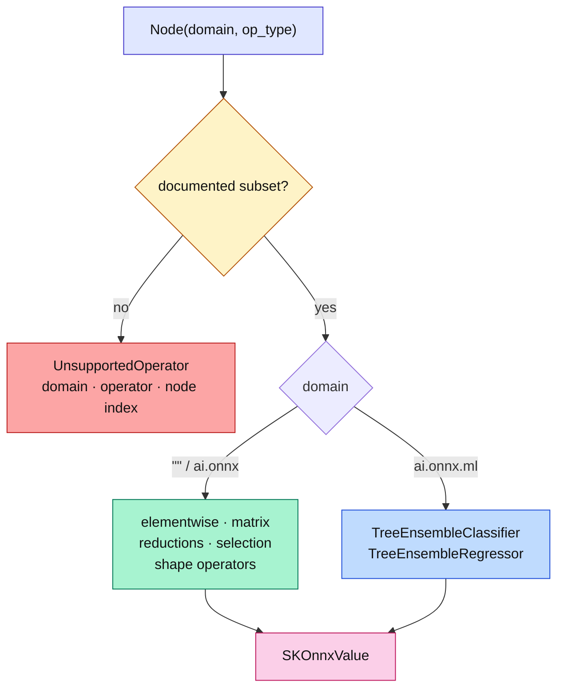
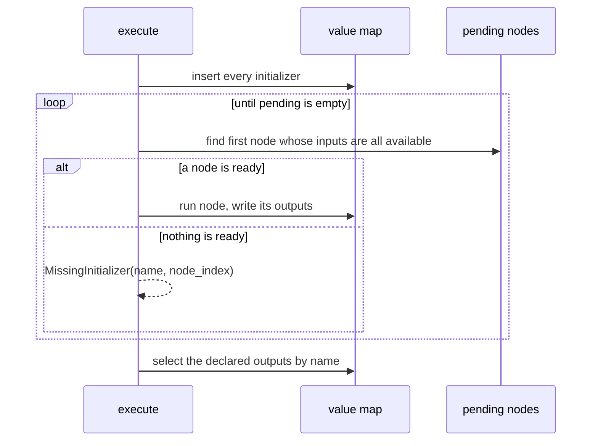

# ONNX import: reading a foreign graph as a model

This chapter explains how `sciencekit` **loads** an ONNX model and runs it as a
predictor — the mirror image of [the export chapter](./ch63-onnx-export.html).
It assumes no Rust knowledge, no numerical-computing background and no ONNX
experience. Every claim points at real code in `crates/sciencekit_onnx` and at a
real companion test you can run.

## From a recipe card to a running model

An ONNX file is a recipe: named inputs, constant tables, operator nodes and
named outputs. Export wrote that card. Import has to *read* it and then *cook*.

```mermaid
flowchart LR
    A["model.onnx<br/>protobuf bytes"] --> B["decode<br/>serde-onnx IR"]
    B --> C["validate<br/>opset · operators · external data"]
    C --> D["analyse interface<br/>one input · prediction head"]
    D --> E["SKOnnxPredictor&lt;F&gt;"]
    E --> F["topological walk<br/>initializers + operators"]
    F --> G["responses or<br/>labels + probabilities"]
    style A fill:#FDE68A,stroke:#B45309,color:#111
    style B fill:#BFDBFE,stroke:#1D4ED8,color:#111
    style C fill:#FCA5A5,stroke:#B91C1C,color:#111
    style D fill:#DDD6FE,stroke:#6D28D9,color:#111
    style E fill:#A7F3D0,stroke:#047857,color:#111
    style F fill:#FBCFE8,stroke:#BE185D,color:#111
    style G fill:#FED7AA,stroke:#C2410C,color:#111
    accTitle: The ONNX import pipeline
    accDescr: Bytes are decoded into the shared IR, validated, analysed to pick a prediction head, wrapped in a predictor, executed by a topological walk and returned as responses or class probabilities.
```



Those five stages are five small modules: `decode.rs`, `model.rs`,
`interface.rs`, `predictor*.rs` and `interpreter.rs`. `mod.rs` is a pure
dispatcher — it only declares modules and re-exports public items, following the
repository convention.

## One IR for both directions

Export used to assemble the graph with hand-declared `prost` messages. Import
would then need its own decoding, and the two vocabularies would inevitably
drift. The change adopted **`serde-onnx`** as the single ONNX intermediate
representation, pinned to revision `0c54592`:

```toml
serde-onnx = { git = "https://github.com/neurono-ml/serde-onnx", rev = "0c54592",
               default-features = false, features = ["import", "export"] }
```

`SKOnnxGraphBuilder` now fills `serde_onnx::ir::Model`; `SKOnnxModel` stores the
encoded bytes **and** that decoded model; `from_bytes` decodes into the very same
type. The exporter and importer therefore share `Node`, `Attribute`, `Tensor`,
`ElemType` and the typed `ai.onnx.ml` operator structs.

One wrinkle is worth recording. The pinned decoder decides "this attribute has a
value" from the encoded protobuf field, and protobuf omits scalar fields equal to
zero. Legal ONNX graphs use `axis = 0` and `keepdims = 0`, so those attributes
looked empty. `import/decode.rs` substitutes a sentinel before decoding and
restores the zero afterwards. The guard is documented as removable once the
pinned revision is bumped.

## Why import is stricter than export

Export knows its own output. Import meets strangers. The loader therefore
refuses, up front and with a **typed** error, everything it cannot honestly run:

| Situation | Error variant |
|---|---|
| Bytes that are not a `ModelProto` | `SKOnnxImportError::InvalidModel` |
| Opset or IR version above the ceiling | `UnsupportedOpset` |
| An operator outside the documented subset | `UnsupportedOperator` (names domain, operator and node index) |
| A value no initializer or earlier node defines | `MissingInitializer` (names the tensor) |
| An initializer stored in another file | `ExternalData` (names the tensor) |
| Input width or tensor shape disagrees | `ShapeMismatch` |
| An element type outside the dense numeric subset | `UnsupportedDtype` |
| No regression head and no coherent classifier head | `UnsupportedOutput` |
| An operator received operands or attributes it cannot execute | `InvalidOperator` |

The rule mirrors the library's philosophy: a precise refusal beats a silent
guess. `a_node_reading_an_undefined_value_names_the_missing_tensor` and
`an_external_initializer_is_rejected_by_name` in `validation_tests.rs` and
`model_tests.rs` are the executable proof.

## The operator dispatch table

The subset is advertised as data, not prose:
`SK_ONNX_SUPPORTED_OPERATORS` lists the default-domain operators and
`SK_ONNX_SUPPORTED_ML_OPERATORS` the two `ai.onnx.ml` tree ensembles.
`sk_onnx_supports_operator(domain, operator)` is the single decision point used
by validation and by the interpreter.



Every value the interpreter moves is a `SKOnnxValue`: `Float32`, `Float64`,
`Int64` or `Boolean` backed by an `ndarray::ArrayD`. Arithmetic broadcasts like
NumPy, and integer operands of `Gather`, `TopK` and `ArgMax` stay integers so
indices are never rounded through a float.

## How a graph becomes a model: the topological walk

ONNX stores nodes in an order, but an interpreter must not *trust* that order —
a valid file may mention a dependency later. `interpreter::execute` keeps a
pending list and repeatedly runs the first node whose every non-empty input is
already available:

$$ \text{ready}(n) \iff \forall\, i \in \text{inputs}(n):\ i = \emptyset \ \lor\ i \in \text{values} $$

Initializers enter the value map first, then each ready node writes its outputs.
If no node is ready, the first node with a missing operand produces
`MissingInitializer` — this is exactly the cycle/typo diagnosis a plain
index-by-index loop would miss.



The tree ensembles show the same walk at a smaller scale. `tree_walk.rs` finds
the root, then follows `nodes_truenodeids` or `nodes_falsenodeids` until it
reaches `LEAF`, accumulating `class_weights` or `target_weights`. Thresholds are
compared in the tree's own comparison mode (`BRANCH_LEQ`, `BRANCH_LT`, …), and a
NaN feature follows `nodes_missing_value_tracks_true` — the ONNX-ML semantics.

## The public objects

- **`SKOnnxModel`** — the shared handle: bytes plus decoded IR. `from_bytes` and
  `from_file` decode and validate; `inputs`, `outputs`, `opset`, `node_count`,
  `initializer_count` and `model()` expose the interface. `model_tests.rs` walks
  all of them on an affine fixture.
- **`SKOnnxPredictor<F>`** — the generic predictor. It implements both
  `SKRegressorPredictor<F>` (`predict`) and `SKClassifierPredictor<F>`
  (`predict_labels`, `predict_probabilities`), plus `predict_arrays`, which
  returns every declared output by name. A method whose head the model does not
  declare returns `UnsupportedOperation` rather than guessing.
- **`SKOnnxPredictorBuilder<F>`** — the mandatory builder. Attach `.model(...)`,
  `.model_bytes(...)` or `.model_file(...)` and call `.build()`; only `build`
  performs interface analysis.
- **`SKOnnxImportError`** — the typed taxonomy above.
- **`SK_ONNX_SUPPORTED_OPERATORS` / `SK_ONNX_SUPPORTED_ML_OPERATORS` /
  `sk_onnx_supports_operator`** — the operator contract as data.

Head analysis is deliberately simple: one required dense float matrix input;
one integer label output plus one float matrix is a classification; a single
float output is a regression (one column for `predict`, any width for
`predict_arrays`); an integer-only output is labels-only. Anything else is
`UnsupportedOutput`.

## The decisions and the roads not taken

- **`tract-onnx 0.22`** was spiked. It builds on Rust 1.85, but it brings its own
  IR and a large dependency tree to run operators the library itself exports.
  The change chose the shared-IR interpreter instead: a smaller dependency
  surface and one model vocabulary for both directions.
- **`ort`** (the official runtime binding) requires Rust 1.92, above the
  project's MSRV, so it was never a candidate.
- **A dynamic-shape, quantized, string-tensor interpreter** is out of scope and
  is rejected explicitly rather than half-supported. `ExternalData` is refused
  because reading side files is a security and portability decision of its own.
- **Computing everything in `f64`** would have been simpler but would drift from
  `onnxruntime` on `f32` models; the interpreter keeps the operand dtype and
  promotes only for genuinely mixed arithmetic.

## Walking the tests

The companion tests are the executable truth of this chapter:

- `identity_graph_returns_its_input_unchanged` (`interpreter_tests.rs`) proves
  the adapter without any learned tensor.
- `parsed_model_exposes_inputs_outputs_and_counts` and
  `invalid_bytes_return_a_structured_error` (`model_tests.rs`) cover metadata
  and the first typed refusal.
- `affine_regressor_matches_the_closed_form`,
  `feature_width_mismatch_is_rejected_before_inference` and
  `non_finite_input_is_rejected` (`predictor_tests.rs`) cover the regression
  surface.
- `softmax_classifier_exposes_labels_and_probabilities` and
  `two_float_outputs_are_an_ambiguous_head` (`classifier_tests.rs`) cover the
  classifier surface.
- `a_large_batch_preserves_the_row_count_and_agrees_row_by_row` and
  `classifier_batches_agree_row_by_row` (`batch_tests.rs`) prove batching.
- `an_unsupported_operator_is_rejected_with_its_name` (`operators_tests.rs`)
  proves the documented subset is enforced.
- `a_node_reading_an_undefined_value_names_the_missing_tensor` and
  `an_integer_feature_input_is_rejected_as_an_unsupported_dtype`
  (`validation_tests.rs`) prove the stricter-than-export contract.
- `linear_regression_round_trips_through_export_and_import`,
  `standard_scaler_round_trips_through_export_and_import`,
  `decision_tree_classifier_round_trips_through_export_and_import` and
  `pipeline_regressor_round_trips_through_export_and_import`
  (`round_trip_tests.rs`) close the loop against the original Rust model.
- `concurrent_predictions_match_the_sequential_result`
  (`concurrency_tests.rs`) proves a loaded predictor is `Send + Sync` and
  deterministic.

Finally, the external proof lives in
`crates/sciencekit_onnx/validation/compare_with_onnxruntime.py`. Run
`cargo run -p sciencekit_onnx --example validate_import <fixture-root>` and then
the harness: it compares the Rust prediction, `onnxruntime` and the imported
prediction on identical inputs and reports the matched/total counts. Today all
36 exported fixtures match on both counts, which is why the import contract is
backed by a real runtime rather than by hope.
