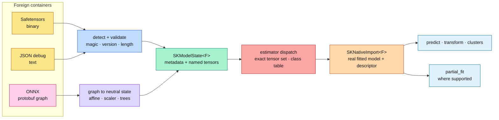

# Native model import: from a foreign file back to a real model

This chapter explains what it means to **import a model natively**, and why the
library does it in two stages — first into a neutral state, then into a concrete
fitted type. It assumes no Rust, no machine-learning and no ONNX background.
Every claim points at real code under `crates/sciencekit_interop/src/native/`
and `crates/sciencekit_onnx/src/native/`, and at a companion test you can run.

The previous chapters built two halves of the story:
[export](./ch62-model-export-retrofit.html) gave every fitted model a neutral
`SKExportable` state, and [ONNX import](./ch64-onnx-import.html) taught the
library to *run* a foreign graph. Native import connects them: the file is read
into that same neutral state and then rebuilt into the model type it originally
was.

## "Native" versus "generic"

A generic predictor answers one question: *given these features, what comes
out?* It is a black box. You cannot inspect its coefficients, put it in a typed
pipeline, save it as Safetensors again, or train it further.

A **native** import returns the real type: `SKLinearRegressionModel<F>`,
`SKLogisticRegressionModel<F>`, `SKStandardScalerModel<F>`, a decision tree, a
random forest or a k-means model. That object implements the same prediction
traits, records the same backend in its spans and, where the algorithm keeps the
learning state, accepts more data through `partial_fit`.



## Why a neutral state beats per-runtime loaders

The tempting shortcut is one loader per producer: a scikit-learn loader, an
ONNX loader, a Safetensors loader, each knowing every estimator. That design
fails in three ways.

1. **Combinatorial drift.** *producers × estimators* is a matrix. Each new
   producer must re-learn every estimator's private field layout.
2. **Hidden partial models.** A loader that half-recognizes a file tends to
   return a half-initialized object.
3. **No shared validation.** Each path invents its own idea of "missing
   tensor", "wrong dtype" or "unknown version".

The neutral `SKModelState<F>` already solved this for export: metadata (stable
estimator name, format version, scalar type, feature count, class table,
typed hyperparameters) plus a deterministic map of named tensors. Native import
reuses it. Safetensors and JSON are just two ways to fill the same container;
ONNX is a third producer that *computes* the container from a graph. After that
point there is exactly one validator and one dispatch table.

## The trust boundary: validate before you construct

A model file is untrusted input. `SKNativeImportError` names each failure with
its own variant, and the checks run in a fixed order so a later stage never
sees bytes a former stage could not trust.

| Stage | Rejects | Error variant |
|---|---|---|
| Container detection | neither JSON nor Safetensors | `WrongMagic` |
| Length | header announces more bytes than exist | `TruncatedFile` |
| Version | a major version this build cannot read | `UnknownFormatVersion` |
| Tensor set | a required tensor is absent | `MissingTensor` |
| Tensor set | an unknown tensor is present | `UnexpectedTensor` |
| Shape | a tensor disagrees with its declared shape | `ShapeMismatch` |
| Class table | labels and score heads disagree | `ShapeMismatch { tensor: "class_labels" }` |
| Family | no importer covers the estimator name | `UnsupportedFamily` |
| Graph | an operator outside the documented subset | `UnsupportedConstruct` |

Two of those deserve emphasis. **Extra tensors are rejected, not ignored.** An
unknown tensor means the file was produced by a different estimator or a newer
format; silently dropping it would hide a version skew. And **the class table is
validated against the declared class count**, because accepting a three-label
table on a two-head binary model would predict the wrong label without any
error.

Not one of these paths unwraps a caller-controlled length or index; the code
uses `get`, `try_into` and checked arithmetic, so a hostile file becomes a typed
error rather than a panic.

### Format detection is structural

The JSON debug format and the Safetensors header are both JSON-shaped, so the
discriminator cannot be "does it look like JSON". A JSON document begins with
`{`; a Safetensors file begins with an eight-byte little-endian header length.
Compressed Safetensors keep a compression magic, so they are recognized first.
`sk_detect_native_model_format` implements exactly that rule:

```text
first bytes == gzip/brotli/snappy magic  → Safetensors
first non-space byte == '{'              → JSON (parse and check format_version)
otherwise: read u64 length, check bounds → Safetensors
```

`native_import_rejects_wrong_magic`, `native_import_rejects_a_truncated_container`
and `native_import_rejects_an_unknown_json_version` exercise those branches.

## The affine models

Many producers emit a linear model as two operators:
$\hat{y} = XW + b$. The mapper reads the `MatMul` weight $W$ and the optional
`Add` bias $b$. If the graph also contains `Sigmoid` or `Softmax`, it is a
classifier; otherwise a regressor.

For a regressor with one output column, the native state is

$$
\hat{y}_i = \sum_{j=1}^{d} w_j x_{ij} + b ,
$$

stored as `linear.coefficients` (length $d$), `linear.intercept`, a zero rank and
an empty singular-value vector. Those last two are not produced by a foreign
graph; the math that computed them (a QR or SVD solve) is gone, and the
prediction function does not need them.

For a classifier, ONNX stores $W$ as $d \times h$ (features × heads), while the
native logistic model stores $h \times d$. The mapper transposes and records
`number_of_classes`, `strategy = binary` when $h = 1$, `strategy = multinomial`
otherwise, plus the class table. For multinomial scores the model applies

$$
p_k(x) = \frac{\exp(z_k)}{\sum_{j=1}^{h}\exp(z_j)}, \qquad z = xW + b,
$$

which is exactly the graph's `Softmax`.

## The scalers

All three scalers are per-column affine maps, so a graph alone is ambiguous
between them. The mapper therefore uses the **stable initializer names** a
sciencekit export writes — `standard_scaler.mean`, `minmax_scaler.minimum`,
`robust_scaler.center` — when the estimator metadata is present. For a standard
scaler the transform is

$$
z_j = \frac{x_j - \mu_j}{\sigma_j},
$$

and the neutral state additionally needs the running moments a stream update
keeps. Those are synthesized as $\text{moments\_mean} = \mu$ and
$\sum (x-\mu)^2 = \sigma^2$ for the imported snapshot: predictions use only
$\mu$ and $\sigma$, and a fresh continued fit rebuilds the true moments from new
data.

## The trees

ONNX-ML stores an ensemble as flat parallel arrays: per node a tree id, a node
id, a feature id, a mode (`BRANCH_LEQ` or `LEAF`), a threshold, true and false
child ids; per leaf a target weight (regressor) or class weights (classifier).
The native state stores the same tree as parallel arrays where the node's
*position* is its id and children are positions. The mapper therefore groups by
tree id, sorts nodes, builds an id→position map and remaps every child pointer;
a leaf gets split feature $-1$ and threshold $0$.

A forest export scales each member's leaves by $1/T$ so the ONNX sum is the
forest average:

$$
\hat{y}_{\text{forest}} = \frac{1}{T}\sum_{t=1}^{T} \text{leaf}_t(x).
$$

The native forest averages its members itself, so the importer multiplies each
restored leaf by $T$ before writing it into `forest.tree.{i}.t.tree`. The test
`native_safetensors_round_trips_tree_and_forest` checks the Safetensors half;
the ONNX half is covered by `native_onnx_imports_an_exported_decision_tree`.

A forest **classifier** would additionally need each member's local class table
to be reconstructed, and that mapping is not recoverable from the ONNX weights
alone. It is reported as `UnsupportedOperator { operator:
"TreeEnsembleClassifier" }` rather than guessed; the generic predictor remains
available for that graph.

## One result type, several surfaces

`SKNativeImport<F>` is an enum with four variants — `Classifier`, `Regressor`,
`Transformer`, `Clusterer` — each carrying the concrete model and an
`SKNativeModelDescriptor`. The descriptor preserves the estimator name, feature
count, class table, backend kind and the family's `SKRetrainingSupport`.

A closed enum is deliberate. The prediction traits in `sciencekit_common`
(`SKRegressorPredictor`, `SKClassifierPredictor`, `SKFeatureTransformer`,
`SKClustererPredictor`) have generic methods over the input type, so they are
not object-safe: you cannot write `Box<dyn SKRegressorPredictor<F>>`. The enum
keeps the concrete types and dispatches one match per surface:

```text
predict_regression   → only a Regressor answers
predict_labels       → only a Classifier answers
predict_probabilities
transform            → only a Transformer answers
predict_clusters     → only a Clusterer answers
```

Wrong-surface calls return `UnsupportedOperation`; they never guess.

## Continued training

The import result records whether the family keeps a learning state.
`SKRetrainingSupport::Supported` is set only where continuing is honest:

| Family | Continued fitting | Why |
|---|---|---|
| `SKSGDRegressor`, `SKSGDClassifier` | yes | the iterate is the model; `partial_fit` continues it |
| `SKLogisticRegression` | yes | refitted through `warm_start_from` from the imported coefficients |
| `SKLinearRegression` | no | an OLS state carries no accumulated design; use SGD |
| trees, forests, scalers, k-means | no | inference-only after conversion |

`native_retrain_logistic_regression_warm_starts_from_the_import` builds the
reference with the same warm-start builder and asserts identical labels and
probabilities. `native_retrain_guidance_explains_why_a_family_is_inference_only`
asserts that rejection names the operation and the reason instead of silently
resetting coefficients.

## The public objects

- `SKNativeImport<F>` and `sk_import_native_state` — dispatch a neutral state
  to a native model.
- `SKNativeImportError` — the typed trust-boundary failure surface.
- `SKNativeModelFormat` and `sk_detect_native_model_format` — structural
  container detection with version and length checks.
- `sk_import_native_model_from_bytes` / `..._from_path` — container → state →
  native model in one call.
- `SKNativeModelDescriptor` and `SKRetrainingSupport` — what the conversion
  preserved and what it can do next.
- `SKNativeImportCoverage` and `sk_native_import_coverage` — the documented
  matrix, read by tests so an advertised family is an exercised family.
- `SKOnnxNativeImporter` — builder-only ONNX conversion (`backend`,
  `execution_mode`, `model`, `model_bytes`, `model_file`, `build::<F>`).
- `SKOnnxNativeError` — `UnsupportedOperator`, `UnsupportedEstimator`,
  `InvalidGraph`, `Native`, `Onnx`.

Every public operation records the configured backend kind in its observability
span; the ONNX importer also records the estimator and feature count.

## The companion tests, walked through

Run them with:

```sh
cargo test -p sciencekit_interop native_
cargo test -p sciencekit_onnx native_
cargo test -p sciencekit_linear_model native_retrain
```

- `native_safetensors_round_trips_linear_regression` exports a fitted linear
  model, reads the bytes back and asserts the predictions are **equal** — not
  merely close, because no arithmetic happens between export and prediction.
- `native_json_round_trips_standard_scaler` does the same through the JSON debug
  format. It is the reason `serde_json` enables `float_roundtrip`: without it,
  parsing shortened decimals is off by one ULP and predictions drift.
- `native_safetensors_round_trips_tree_and_forest` covers both tree state
  shapes. It exists because tree export used to write a NaN threshold at every
  leaf, which the Safetensors writer rejects as non-finite; leaves now write
  zero and the importer still treats them as leaves by their split feature.
- `native_onnx_imports_an_exported_logistic_regression` checks labels,
  probabilities and the preserved class table.
- `native_onnx_matches_onnxruntime_for_an_external_classifier` loads an ONNX file
  built outside the crate and compares the native probabilities and labels to
  values recorded from `onnxruntime`. Run
  `python3 crates/sciencekit_onnx/validation/compare_native_import.py \
  crates/sciencekit_onnx/validation/external` to reproduce the reference half.
- `native_import_rejects_an_unexpected_tensor` proves the trust boundary is
  bidirectional: a file that carries an extra tensor is rejected.
- `native_validation_concurrent_conversions_are_identical` converts the same
  bytes on eight threads and compares the probability matrices.
- `native_validation_a_failed_conversion_leaves_no_model` shows that a rejected
  attempt has no side effect: the intact state still converts afterwards.

## Decisions and roads not taken

**Closed enum instead of a trait-object registry.** A plugin registry would let
families register themselves, but linkage order would decide which importer
wins, and `F` is generic, so a static registry needs either monomorphized
vectors or an inventory-style dependency. The enum is smaller, exhaustive and
reviewable.

**Exact tensor sets instead of "read what you need".** Ignoring extra tensors is
convenient until a file from a newer format is silently accepted with the wrong
semantics. The exact set makes version skew loud.

**One ONNX subset, documented.** Arbitrary graphs, neural networks and LoRA are
out of scope. Supported today: affine regression/classification (including the
`sigmoid`, `softmax` and `argmax` heads), the three per-column scalers and
single decision trees; forests are supported for regressors, with the classifier
case returning a named error.

**No pin bump.** The change keeps `serde-onnx` at revision `0c54592` and its
narrow zero-attribute sentinel in `import/decode.rs`. Bumping to the upstream fix
is a separate decision that must delete the shim and prove it is unused.

**NaN leaves became zero.** The Safetensors and JSON formats both enforce finite
values. Writing `0` at a leaf is lossless for prediction because leaves are
identified by a negative split feature; it also makes every tree state
serializable without exception.
