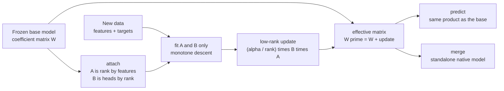

# Low-rank adapters: teaching a frozen model a small new trick

This chapter explains **low-rank adaptation (LoRA)** as sciencekit implements it:
a frozen fitted model stays exactly as it is, and a tiny pair of matrices learns
a correction on new data. It assumes no Rust, no linear algebra and no prior
machine-learning background. Every claim points at real code under
`crates/sciencekit_linear_model/src/adapters/lora/` and at a companion test you
can run.

The story follows one question. A library user has a fitted model that works
well, then receives fresh data from a slightly different distribution. Retraining
the whole model is expensive and risks forgetting what it already knew. What if
the model could learn *just the part that changed*, while the original weighs
nothing in the loss?

## The problem: moving a wall you already built

A linear model stores one number per feature, its **coefficient**, plus one
**intercept**. For a linear regressor, prediction is the dot product of the
feature row with the coefficient vector, plus the intercept. A logistic
classifier stores one coefficient vector per class head and turns the resulting
scores into probabilities.

Those numbers are what the model learned. Rewriting them means throwing away the
old solution and solving the whole problem again, now on a mixture of old and new
data — and, with a limited amount of new data, the old knowledge can quietly
drift away.

Low-rank adaptation takes a different road: **freeze** the old numbers and learn
a small correction next to them. The correction is added at prediction time.

## The idea in one picture



The left side of the picture never changes. Everything the optimizer touches is
the two thin matrices under `fit A and B only`.

## What "low-rank" means, and why it is cheap

A full coefficient block `W` for a logistic classifier with `p` heads and `d`
features has `p × d` numbers. A low-rank correction replaces that dense block
with two thin factors:

- `A` is `r × d` — one row per **rank** `r`;
- `B` is `p × r` — one column per rank.

Their product `B A` is a `p × d` matrix, but it is built from only
`r · (p + d)` numbers. The adapter stores `A` and `B`, never the product.

The update applied to the base is:

$$W' = W + \frac{\alpha}{r} B A$$

The factor $\frac{\alpha}{r}$ is the **scaling**. In the code it is a method on
the configuration:

```rust
/// The update scale `alpha / r`.
pub fn scaling(&self) -> F {
    F::from(self.rank).map_or(F::one(), |rank| self.alpha / rank)
}
```

With rank 8 and alpha 16 the scaling is exactly 2 — that is the first companion
test, `scaling_is_alpha_divided_by_rank`. Dividing by the rank makes the
correction's magnitude roughly independent of how many factors are used, so
changing the rank does not silently change the step size of the update.

Chapter code lives in `core_implementation.rs`; the target selection lives in
`config.rs` and is a closed enum, `SKLoraTargetModule`, with one variant for
linear coefficients and one for logistic coefficients. A closed enum means a
misspelled target cannot compile, and a mismatched target becomes a typed error
rather than a silent no-op.

## One object per responsibility

| Public object | File | What it is |
|---|---|---|
| `SKLoraAdapter<F>` | `core_implementation.rs` | Immutable configuration: identifier, rank, alpha, target, backend, optimizer budget. |
| `SKLoraAdapterBuilder<F>` | `builder.rs` | The only way to construct an adapter; rejects rank zero, non-finite alpha, empty identifiers and a zero iteration budget. |
| `SKLoraTargetModule` | `config.rs` | Which coefficient block is adapted. |
| `SKLoraBaseModel<F>` | `base_model.rs` | A frozen fitted model: linear, logistic, or an explicitly unsupported family. |
| `SKLoraAttachedModel<F>` | `attached_model.rs` | Base plus the trainable `A`/`B` factors; the object you fit and predict with. |
| `SKLoraMergedModel<F>` | `merge.rs` | A native model with the update folded in; can be unmerged. |
| `SKLoraAdapterArtifact<F>` | `artifact.rs` | An imported adapter before it is paired with a base. |
| `SKLoraAdapterRegistry<F>` | `registry.rs` | Adapters keyed by identifier, rejecting duplicates. |

Construction is builder-only, as everywhere in the library. The adapter's
defaults are documented in `builder.rs` and verified by
`defaults_are_documented_and_stable`: rank 4, alpha 1, linear target, `Faer`
backend, automatic execution mode. Every public operation records the configured
backend in its observability span — `sk_prediction_attributes` in `prediction.rs`
does exactly that for prediction, and `fit_linear`/`fit_logistic` build the same
attributes before their descent loops.

## Freezing the base

`SKLoraBaseModel::linear_regression` and `::logistic_regression` wrap an already
fitted model. Attaching validates three things before allocating anything:

1. the base family has a coefficient block (trees and neighbours do not);
2. the adapter's target module matches the base family;
3. the base has at least one feature and one head.

A family without a coefficient block enters as
`SKLoraBaseModel::unsupported_family("decision_tree")` and attaching returns
`UnsupportedOperation` with a reason naming the family. That is the
`an_unsupported_base_family_is_rejected` test, and the requirement that no
unsupported path panics.

The factors start deterministically: `B` is all zeros and `A` is a small,
fixed pattern computed from its indices. Because `B` is zero, the initial update
is exactly the zero matrix. That is why `a_zero_adapter_predicts_exactly_like_the_base`
can assert **bit-for-bit** equality with the frozen base, not merely a
tolerance.

## Fitting only the thin matrices

`SKLoraAttachedModel::fit` dispatches once on the target module and hands the
work to `fitting/linear.rs` or `fitting/logistic.rs`:

- A regression base consumes continuous targets and minimizes the mean squared
  error.
- A classifier base consumes canonical integer class indices and minimizes the
  logistic loss — binary cross-entropy for one head, softmax cross-entropy for
  several.

Both descents share the same discipline:

- the gradients are computed from the residual (regression) or the probability
  error (classification), never from a dense copy of a sparse input;
- `sk_transposed_feature_product` in `fitting/gradients.rs` handles dense and CSR
  designs, so `Xᵀ` never requires densifying;
- each accepted iteration must **strictly decrease** the loss. A backtracking
  loop halves the step up to a fixed number of attempts before accepting it, so
  the reported loss is monotone even when the data has a difficult scale.

The training verdict is observable through `training_loss`, which returns the
same number the optimizer minimizes. It validates its inputs exactly like `fit`
does before touching the loss: a feature count that disagrees with the base, a
target vector whose length disagrees with the rows, and a non-finite feature or
target all return a typed error instead of panicking or silently truncating
(`training_loss_rejects_a_feature_count_that_disagrees_with_the_base`,
`training_loss_rejects_a_target_count_that_disagrees_with_the_rows`). The test
`fitting_reduces_the_training_loss_below_the_frozen_base` compares the loss before
and after the fit on a shifted relationship, and
`fitting_reduces_the_logistic_loss_below_the_frozen_base` does the same for a
classifier on a rotated decision rule.

Determinism matters as much as convergence: there is no random initialization.
`two_fits_on_the_same_data_produce_identical_factors` fits twice and asserts that
`A` and `B` are equal, which is what lets an exported adapter be reproduced.

## Applying versus merging

There are two ways to use a trained adapter, and they answer different needs.

**Apply** keeps the base frozen and adds the update at prediction time. Every
prediction computes the effective block and applies the base's own matrix
product:

```rust
/// The adapted parameter block `W + (alpha / rank) · B A`.
pub(crate) fn effective_coefficients(&self) -> Result<Array2<F>, SKError> {
    Ok(self.base.coefficients()? + self.delta())
}
```

**Merge** folds the update into a standalone native model:

```rust
pub fn merge(&self) -> Result<SKLoraMergedModel<F>, SKError> { ... }
```

The merged model carries a real `SKLinearRegressionModel` or
`SKLogisticRegressionModel` whose coefficient block is `W'`, and `unmerge`
returns the original frozen base plus the adapter. Because apply and merge use
the same effective block and the same scoring helper, predictions are not merely
close: `merged_prediction_reproduces_the_attached_prediction_exactly` asserts
bit-for-bit equality.

The numerical proof is the pair of tests
`merged_coefficients_equal_the_hand_computed_low_rank_update` and
`the_low_rank_reference_holds_for_single_precision`. They set known factors,
compute the reference $\frac{\alpha}{r} B A$ explicitly in the test, add it to
the base block by hand, and check that the adapter's predictions differ by less
than `1e-9` — for `f64` and for `f32`. The `f32` case is the interesting one:
the reference uses the fitted intercept, not a hard-coded constant, because the
base intercept itself already carries single-precision rounding.

Prediction never densifies: `dense_and_sparse_predictions_agree_without_densifying`
runs the same rows as a dense matrix and as a CSR matrix and compares the two
result vectors.

## Storing an adapter apart from its base

An adapter is stored **separately** for a practical reason: the base model is
already persisted, often large, and shared by several tasks. Storing the base
again for every adapter would multiply the storage and create many near-copies
that can drift.

`SKExportable` writes a state with metadata (`identifier`, `rank`, `alpha`,
`target`, `heads`, `fitted`, optimizer budget, backend) and exactly two tensors,
`lora.<target>.a` and `lora.<target>.b`. `SKLoraAdapterArtifact` reads them back,
validates the shapes against the metadata, and only then pairs the adapter with a
base through `attach`.

The validation tests stay on the trust boundary: a tampered `B` shape returns
`ShapeMismatch` (`a_tampered_factor_shape_is_rejected_without_a_panic`), a state
without `A` returns `InvalidHyperparameter` (`a_missing_factor_tensor_is_rejected`),
a stored factor carrying `NaN` or infinity returns `NonFiniteValue`
(`a_non_finite_stored_factor_is_rejected_on_import`), and a round trip
reproduces the original predictions exactly
(`a_round_trip_preserves_predictions_exactly`). No untrusted length, shape or
value is ever unwrapped.

`SKLoraAdapterRegistry` addresses several adapters by identifier. Inserting the
same identifier twice is an error naming the identifier
(`duplicate_adapter_identifiers_are_rejected`); the registry never silently
replaces one task's adapter with another's.

## Concurrency and acceptance

`SKLoraAttachedModel<F>` and the registry are `Send + Sync`; the compile-time
check is `an_adapter_is_send_and_sync`. `concurrent_prediction_matches_the_sequential_result`
shares one fitted adapter across eight threads and asserts every result equals
the sequential one. The acceptance tests also cover a single row and a single
feature (`a_one_row_one_feature_fit_still_produces_a_finite_prediction`), a
600-row design (`a_large_design_is_fitted_and_the_loss_falls`), and a three-class
logistic adapter (`a_multiclass_logistic_adapter_runs_and_lowers_the_loss`).

## Decisions and roads not taken

- **Gradual or alternating least squares** were considered for the regression
  fit. The shipped path is a monotone gradient descent with backtracking: it is
  smaller, works for both dense and sparse designs, and every accepted iteration
  can be proven to reduce the loss. Alternating solves remain a possible
  performance upgrade inside `fitting/linear.rs`.
- **Random initialization** was rejected. A deterministic pattern plus a zero
  `B` makes the zero adapter exact, makes two fits identical, and removes a seed
  from the public configuration.
- **Full-model fine-tuning** is out of scope. The base is frozen by construction,
  not by convention.
- **Deep-network LoRA** is out of scope too: the library's current families are
  linear and logistic models with matrix-valued coefficients, and the enum
  `SKLoraTargetModule` says so explicitly. A future neural estimator would add a
  variant, not change this one.
- **Storing the product `B A`** was rejected: it would lose the low-rank
  structure and make the adapter as large as the base block it corrects.

## When you change this code

Keep the three invariants that the tests encode: the zero adapter must reproduce
the base exactly, merge must reproduce apply exactly, and persisted shapes must
be validated before use. When you extend the surface, update this chapter rather
than adding a parallel one; `lora_acceptance_tests.rs` and the other
`lora_*_tests.rs` companions are the executable source of truth.
