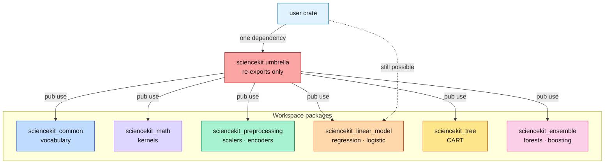
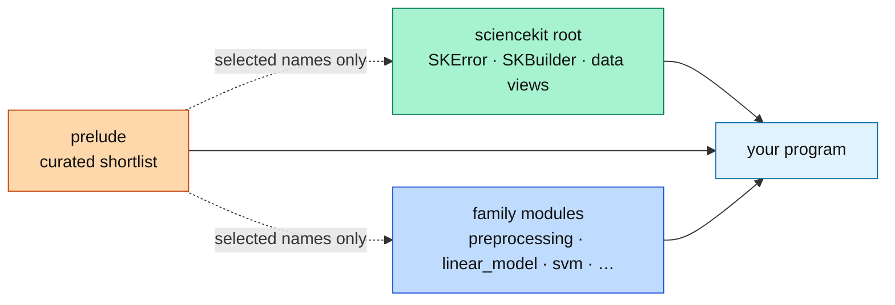

# The umbrella crate: one door into many rooms

This chapter explains what an **umbrella crate** is, why `sciencekit` ships one,
and how it is built without duplicating a single line of algorithm code. It
assumes no Rust and no machine-learning background. Every claim points at real
code under `src/` at the workspace root and at a companion test you can run.

The previous chapters told the story one crate at a time:
`sciencekit_common` fixed the vocabulary, `sciencekit_math` supplied the
kernels, and each algorithm family arrived as its own package. Twenty-one
packages is honest engineering and terrible onboarding: a newcomer has to know
that a scaler lives in `sciencekit_preprocessing`, a cost function in
`sciencekit_common` and a metric in `sciencekit_metrics`. The umbrella answers
the only question a newcomer actually asks: *what do I add to `Cargo.toml`?*

## One dependency, many packages

A Cargo **package** is a named unit with its own `Cargo.toml`; a **crate** is
what it compiles to. The umbrella is a package that owns almost no code of its
own: it depends on the family packages and **re-exports** their public items.
A re-export is a signpost, not a copy — `pub use sciencekit_linear_model::SKRidge;`
means "the name `SKRidge` exists here too, and it is *the same type* the other
crate defines".

That identity matters. If the umbrella defined its own `SKRidge`, a model fitted
through the umbrella would not be accepted by a function written against
`sciencekit_linear_model`, and the ecosystem would split in two. Rust's type
system makes accidental duplicates a compile error precisely so that a
re-export can stay honest: one type, several doors.



## A decision that changed shape: the crate already existed

The original plan said "create `crates/sciencekit`". Cargo refuses two packages
with the same name in one workspace, and the root package was already called
`sciencekit` — an empty `src/lib.rs` kept as the umbrella slot. Creating a
second `sciencekit` was impossible, so the umbrella was implemented **in the
existing root package**: the same public outcome (`sciencekit` is the one crate
users add), one fewer package, and no rename of the published crate.

The only visible consequence is the file layout: the family modules live in
`src/<family>.rs` at the root instead of `crates/sciencekit/src/`. The exported
names and paths are identical either way.

## A prelude is not a glob import

Rust lets you write `use sciencekit::*;` to import everything public at the
crate root. The umbrella deliberately does **not** flatten every family there.
Two reasons, both practical:

1. **Collisions.** Three different families own a type called `SKClassWeight`:
   the tree/ensemble split policy, the logistic-regression class policy and the
   support-vector-machine policy. They are different types with different
   fields. Flattening them into one namespace would force a rename that lies
   about the domain, or would silently drop two of them.
2. **Compile time and documentation noise.** A glob pulls in hundreds of
   names, most of which a given program never uses. Documentation pages become
   a wall of unrelated items.

A **prelude** is the opposite design: a small, curated module with a stable
list of names that are almost always wanted together — the builder and fit
traits, the data views, the error type, the scalar bound, and one or two
headline estimators per family. You opt in with
`use sciencekit::prelude::*;`, and you opt out of the noise. When a name is not
there, its family module is one import away.



The collision decision is executable. The companion test
`colliding_names_live_in_their_family_modules` in `src/reexports_tests.rs`
asserts that all three `SKClassWeight` types resolve through their own module,
and that duplicated *identities* stay identical:

```rust
sized::<crate::tree::SKClassWeight<f64>>();
sized::<crate::linear_model::SKClassWeight<f64>>();
sized::<crate::svm::SKClassWeight<f64>>();

sized::<crate::SKFeatureBlock<f64>>();
sized::<crate::pipeline::SKFeatureBlock<f64>>();
```

The second pair is the safe case: `sciencekit_common` owns `SKFeatureBlock`,
and the pipeline crate deliberately re-exports that same type rather than
inventing a block of its own. Two doors, one room.

## The build → fit → predict walk-through

The executable form of "the prelude is enough" is
`prelude_builds_fits_and_predicts` in `src/prelude_tests.rs`. It imports only
`sciencekit::prelude::*` and runs a complete, if tiny, learning program:

```rust
let scaler = SKStandardScaler::build().build().unwrap();
let scaled = scaler.fit(features.view()).unwrap();
let scaled_features = scaled.transform(features.view()).unwrap();

let model = SKLinearRegression::build()
    .build()
    .unwrap()
    .fit(scaled_features.view(), targets.view())
    .unwrap();
let predictions = model.predict(scaled_features.view()).unwrap();
```

Read it as three sentences. `SKStandardScaler::build()` starts a builder — the
library's uniform configuration surface — and the second `.build()` validates
the configuration and returns the estimator. `fit` learns from the design and
returns a **distinct fitted model**; the estimator itself never mutates, so "not
yet fitted" is unrepresentable. The regression step solves the ordinary
least-squares problem

$$
\hat{\beta} = \arg\min_{\beta \in \mathbb{R}^{p}} \; \lVert X\beta - y \rVert_2^2 ,
$$

and `predict` evaluates $\hat{y} = X\hat{\beta}$ on the same scaled design. The
test then checks that every prediction is within $10^{-6}$ of its target — a
trivial tolerance because the synthetic data is exactly linear.

The second test, `prelude_exposes_metrics_for_a_fitted_model`, closes the loop
with a score reachable from the same prelude:

$$
\text{accuracy}(y, \hat{y}) = \frac{1}{n} \sum_{i=1}^{n} \mathbf{1}\!\left[\hat{y}_i = y_i\right] .
$$

Its inputs are plain slices and its output is generic over the scalar bound, so
the test writes `let score: f64 = sk_accuracy_score(&truth, &predicted).unwrap();`
and asserts the expected $0.75$ on four labels.

## Optional integrations behind features

The umbrella compiles the core by default and nothing else. Three integrations
pull in substantial dependency trees — an OpenTelemetry SDK, the ONNX
translator, the GPU runtime — and four engine adapters pull in Polars,
DataFusion, Arrow/Parquet or memory mapping. Making them mandatory would tax
every user for a capability most never use.

Cargo **features** solve this. A feature is a named switch that turns
dependencies on. The umbrella forwards rather than duplicates:

```toml
[features]
default = []
opencl = [
    "dep:sciencekit_gpu_opencl",
    "sciencekit_gpu_opencl/gpu-opencl",
    "sciencekit_gpu/opencl",
]
telemetry = ["dep:sciencekit_telemetry"]
onnx = ["dep:sciencekit_onnx"]
parquet = ["sciencekit_interop/parquet"]
```

The `dep:` syntax means "enable this optional dependency without also creating
a public feature of the same name" — the umbrella's feature names are its own
vocabulary, not an accident of package names. `sciencekit_gpu_opencl/gpu-opencl`
reaches into the sub-crate's own feature, so the two switches cannot disagree.

Features are **additive**: enabling one never removes core code. The companion
test `optional_integrations_mirror_their_features` in `src/features_tests.rs`
wraps each reachability assertion in its `#[cfg(feature = "...")]`, so the same
test file proves the core in a bare build, the ONNX re-exports under `--features
onnx`, the adapters under `--features polars`, and so on. The CI matrix runs
`cargo check -p sciencekit --no-default-features` plus one build per feature;
the test is the part that stays with the code.

## Roads not taken

- **One giant crate.** Folding every algorithm into `sciencekit` would remove
  the dependency graph but destroy independent consumption: a user who wants
  only a scaler would compile forests and ONNX with it. The workspace keeps
  twenty-one small packages and one thin door.
- **Flattening every family at the root.** Convenient until the first
  collision, then either a rename that misleads or a silent omission. Named
  modules keep the taxonomy visible.
- **A prelude that re-exports everything.** The prelude would become a second
  glob with worse documentation. The shortlist is intentional; the family
  modules remain the full catalogue.
- **Making the umbrella a version line of its own.** It inherits
  `version.workspace = true`, so a release bumps one line and every re-export
  points at the matching sub-crate version.
- **Adding a `lora-adapters` module now.** That capability is being implemented
  in a parallel change. The umbrella will re-export it once it lands, as a
  follow-up; depending on an unfinished crate would make this change's build
  nondeterministic.

## What the reader should take away

An umbrella crate is a **documentation and onboarding decision**, not an
algorithmic one. It adds no logic, no state and no version line; it adds a
stable set of doors, a curated prelude, and feature switches that keep the
default build small. When you add a new family, extend the matching family
module, add one or two headline names to the prelude only if they are broadly
useful, gate any heavy dependency behind a forwarded feature, and extend the
three companion tests — `reexports_tests`, `prelude_tests` and
`features_tests` — so the book and the code keep telling the same story.
