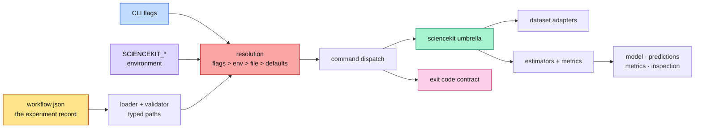

# The workflows CLI: a reproducible experiment in one file

This chapter explains the `sciencekit` command-line interface from zero: why a
library that already has a Rust API ships a binary, what a workflow file records
and why it is versioned, how a value is resolved when a flag, an environment
variable, a file and a default disagree, and why exit codes are part of the
public contract. Every claim points at real code under
`crates/sciencekit_cli/src/` and at an integration test that runs the compiled
binary.

The previous chapter opened one door into the library: the umbrella crate. This
chapter adds a second door for people who do not write Rust. Both doors lead to
the same algorithms; neither keeps a private copy.

## Why a CLI over the library

A Rust API answers "how do I call a function". It does not answer "how do I
rerun last week's experiment on a new machine". That second question needs three
things the library cannot own by itself:

1. **A file format for the experiment.** Which dataset, which target column,
   which scaler, which estimator, which penalty grid, which metrics, which
   output paths.
2. **A resolution rule.** The same experiment must accept an override from a
   shell script without editing the file.
3. **A process contract.** Automation needs a number it can branch on, not a
   sentence printed to a terminal.

The binary is a thin orchestration layer. It parses arguments, resolves the
configuration, calls the umbrella crate and writes the declared artifacts. It
never reimplements a scaler, a metric or a model format. That boundary is a
design decision, not a limitation: a second implementation would drift from the
library every time an algorithm changed.



## The workflow schema is a reproducible experiment record

A workflow is a JSON or TOML document (YAML behind the `yaml` feature) with a
`version` and up to five sections: `dataset`, `pipeline`, `estimator`, `search`,
`metrics` and `output`. The structs live in
`crates/sciencekit_cli/src/workflow/schema.rs`; the version is
`SK_WORKFLOW_SUPPORTED_VERSION = 1`.

```json
{
  "version": 1,
  "dataset": { "format": "csv", "path": "data.csv", "target": "y" },
  "pipeline": [{ "transformer": "standard_scaler", "with_mean": true }],
  "estimator": { "name": "ridge", "alpha": 1.0 },
  "search": { "kind": "grid", "alphas": [0.1, 1.0], "folds": 2 },
  "metrics": ["r2", "rmse"],
  "output": { "model": "model.safetensors", "predictions": "predictions.csv" }
}
```

The schema is deliberately **versioned**. A future release can add a section
without guessing what an old file meant, and an old binary can refuse a future
file instead of silently ignoring half of it. The loader
(`workflow/loader.rs`) parses every format into one JSON value, runs
`sk_validate_workflow_value` and only then deserializes into `SKWorkflow`.
Validation is **typed**: `SKWorkflowError` in `workflow/error.rs` distinguishes
an unsupported version, an unknown field, a missing field and a wrong type, and
every variant exposes a dotted `path()` such as `workflow.estimator.alpha`.
Unknown keys are rejected on purpose — a typo in `alpha` must fail loudly, not
fall back to the default.

The version check happens before anything else, so a version-2 file never
reaches an estimator. The integration test
`invalid_workflow_reports_the_offending_path_with_exit_code_two` in
`tests/error_tests.rs` runs the binary against `{"version": 2}` and against a
misspelled estimator key, and asserts both the exit code and the exact dotted
path on stderr.

## Precedence is one equation

Four layers can supply the same value. They are merged in a fixed order, each
layer overwriting only the fields it sets:

$$\text{flags} \succ \text{environment} \succ \text{workflow file} \succ \text{defaults}$$

The code makes that order literal. `config/precedence.rs` builds the defaults,
applies `sk_file_overrides`, then the environment layer, then the flag layer.
Each layer is a `SKConfigurationOverrides` value whose fields are `Option`s:
`None` means "this layer has no opinion", which is exactly what lets a flag win
without erasing the fields it does not set. `SCIENCEKIT_ALPHA`,
`SCIENCEKIT_ESTIMATOR`, `SCIENCEKIT_MODEL` and the other `SCIENCEKIT_*`
variables form the environment layer in `config/environment.rs`.

`--dry-run` renders the **resolved** configuration as JSON and stops before any
artifact is written. It also validates that the dataset exists and that the
output directories exist, so a typo surfaces before a long fit.
`tests/config_tests.rs` proves all four levels in one test,
`precedence_resolves_flags_over_environment_over_file_over_defaults`: the file
sets `alpha = 2.0`, the environment sets `3.0`, a flag sets `4.0`, and the test
asserts `4.0`, then `3.0`, then `2.0`, then the default `1.0`.

## Exit codes are a contract

A shell script cannot parse prose. The binary therefore maps every failure to a
documented number, defined by `SKExitCode` in `cli/exit_codes.rs`:

| Code | Meaning |
|---|---|
| `0` | success; every declared artifact was written |
| `2` | usage or validation: bad flags, invalid workflow, bad value |
| `3` | dataset or model I/O: missing file, malformed artifact |
| `4` | a capability this build was compiled without |
| `1` | an unexpected runtime failure |

The classification lives next to the error type in `src/error.rs`, so a new
command cannot invent a new number. Clap's own usage failures already exit with
`2`, which is why the contract starts there rather than at `1`.
`tests/error_tests.rs` pins three of the five codes against the real process:
an invalid workflow exits `2`, a missing model exits `3`, and a format whose
Cargo feature is off exits `4` with a message naming that feature.

## Every subcommand in one pass

- **`fit`** loads the dataset, optionally fits a feature pipeline, fits a
  regression estimator (`ridge`, `linear_regression`) or a transformer
  (`standard_scaler`, `minmax_scaler`, `robust_scaler`) and writes a model
  artifact. `SKRidge` receives the configured penalty and backend.
- **`predict`** imports the artifact into a native model
  (`sk_import_native_model_from_path`), predicts on the input matrix and writes
  CSV, JSON or Parquet predictions.
- **`transform`** imports a fitted transformer and writes the transformed
  matrix with one column per output feature.
- **`evaluate`** predicts, then computes the selected metrics (`r2`, `rmse`,
  `mse`, `mae`) through `sciencekit_metrics` and prints or writes a JSON
  document.
- **`export`** reads a neutral `SKModelState` and writes Safetensors, JSON or
  ONNX (the last behind the `onnx` feature).
- **`inspect`** prints the estimator name, format version, feature count,
  tensor count and tensor names without loading a model for prediction.
- **`run`** executes the workflow: it loads the dataset, applies every pipeline
  step, optionally runs a K-fold grid search over the penalty candidates
  (`workflow/steps.rs`), fits the winner on the full matrix, computes the
  metrics and writes every declared artifact.

The two end-to-end tests in `tests/command_tests.rs` walk through the whole
surface. `fit_then_predict_inspect_and_export_run_end_to_end` fits ridge on a
six-row linear dataset, predicts, parses the first prediction back into `f64`,
inspects the model, exports it to JSON and inspects the export.
`transform_evaluate_and_run_workflow_produce_artifacts` fits a scaler,
transforms the matrix, evaluates ridge, then runs a workflow with a
`standard_scaler` pipeline and a two-candidate grid, asserting that both the
model and the predictions exist afterwards.

## Features change what the binary can do, never what it means

CSV and Parquet input use the interop Arrow sources; model artifacts use the
interop Safetensors and JSON formats. Parquet output, YAML workflows and ONNX
translation are optional Cargo features. When one is missing, the binary does
not fail with a generic "unsupported": it names the feature and exits `4`, so a
caller can tell a missing build capability from a broken file. The feature
tests in `tests/feature_tests.rs` prove the enabled paths —
`a_yaml_workflow_executes_end_to_end`,
`a_parquet_dataset_fits_and_parquet_predictions_round_trip` and
`onnx_export_and_import_round_trip_a_fitted_model` — while the default build
proves the disabled path with `workflows-cli`'s feature-absent error.

Telemetry is the same idea. When `SCIENCEKIT_OTLP_ENDPOINT` is set,
`src/telemetry.rs` builds an `SKTelemetryConfiguration` from the environment,
initializes the pipeline once, and holds a guard whose `Drop` implementation
flushes and shuts it down. If the endpoint is set but the `telemetry` feature is
off, the process exits `4` instead of pretending it exported anything.

## Decisions and roads not taken

- **A CLI crate, not a binary in the umbrella.** The umbrella adds no logic, so
  putting argument parsing inside it would break that promise and force every
  library user to compile `clap`. `crates/sciencekit_cli` depends on the
  umbrella and is the only package that knows about terminals.
- **Versioned JSON/TOML first, YAML optional.** JSON is unambiguous and TOML is
  pleasant for humans; `serde_yaml_ng` is a small optional dependency rather
  than a mandatory parser.
- **Reject unknown fields.** A permissive schema turns typos into silent
  defaults. The typed validator costs a few dozen lines and saves hours.
- **No server, scheduler, distributed execution, GUI or cloud storage.** Those
  are different products. The binary is one process that finishes.
- **No second estimator implementation.** The CLI composes the same builders the
  Rust API exposes; a feature it cannot express yet is an honest error, not a
  private code path.

## Where to change what

- A new subcommand starts in `cli/arguments.rs`, dispatches from
  `cli/commands/mod.rs`, and lives in its own file under `cli/commands/`.
- A new workflow key starts in `workflow/schema.rs`, then the allowed-key list
  in `workflow/validation.rs`, then the file layer in `config/precedence.rs`.
- A new exit-code meaning is a change to `cli/exit_codes.rs` and `src/error.rs`
  together, plus a test in `tests/error_tests.rs`.
- A new format belongs in `io/`, behind a feature, with a disabled-feature test
  next to the enabled one.

When you change behaviour, edit this chapter rather than adding a parallel one,
and run `mdbook build docs` so the Mermaid diagrams and the links stay truthful.
