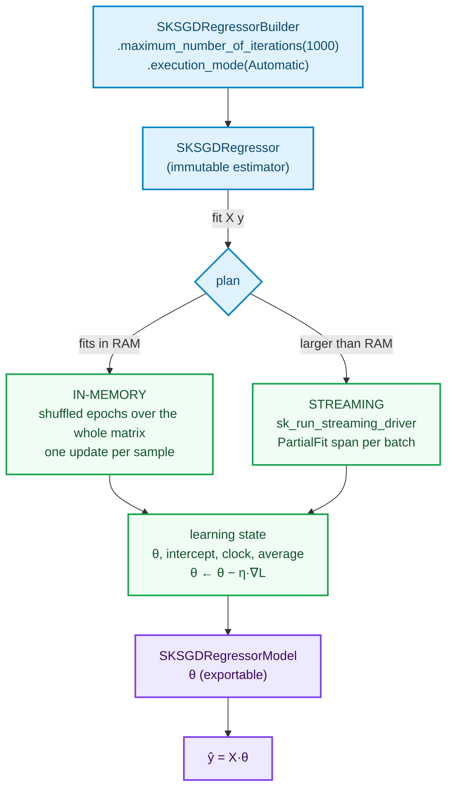

# Adding a Streaming Model — `SKSGDClassifier` and `SKSGDRegressor`

> Pre-read: [How to add an Algorithm](how-to-add-an-algorithm.md) (§5 planning, §7 streaming driver)
> and [Adding a Linear Model](adding-a-linear-model.md) (§2's condition-number warning — this
> chapter is the escape route it promised).

This is the chapter where the library's architecture stops being a compromise. Gradient
descent **is** streaming-native: it consumes one sample (or one batch) at a time, updates an
accumulator, and never asks "give me everything". So the reference code here does not add
streaming to a batch algorithm — it presents the estimator **as a state machine whose
in-memory fit is simply the degenerate case of one batch carrying everything**, exactly the
"one formulation, two regimes" principle from the Tutorials index.

> **Note (Wave 2.5).** This tutorial was written as a design narrative before the
> implementation landed. The shipped code uses **one update per sample**, all four schedules,
> the full loss catalogue and a class table **frozen at fit time**; the code blocks below are
> illustrative of the architecture, not verbatim API. The authoritative, code-grounded
> account is [chapter 17](../development-explained/ch17-sgd-classifier-regressor.html).

## 1. Story & decisions

| Decision | Chosen | Roads not taken — and why they are wrong here specifically |
|---|---|---|
| Update granularity per step | **one sample per update**, wrapped in an epoch loop | Mini-batch updates would vectorize better, but they change the convergence theory and the schedule semantics; scikit-learn's SGD is per-sample and the library keeps parity. |
| In-memory path | The **same** per-sample update over the whole matrix, one epoch at a time | A separate closed-form/batch route would fork the semantics: two "fits" with answers that drift apart on ill-conditioned inputs — the exact problem the dual-regime principle exists to prevent. |
| Learning-rate schedules | all four shipped: `constant`, `inverse_scaling`, `optimal` (with `t₀` estimated from the first batch) and `adaptive` | Dropping `optimal` would break parity; shipping it with a *fixed* constant would hard-code a dataset-dependent number, so the constant is estimated and documented. |
| Losses | the full catalogue: 5 classifier (hinge, log-loss, modified huber, squared hinge, perceptron) and 4 regressor (squared error, huber, epsilon-insensitive, squared epsilon-insensitive); penalties L2/L1/ElasticNet/None | A reduced catalogue would not be scikit-learn-compatible; the substrate pays for the catalogue once and both estimators reuse it. |
| PartialFit spans | Every batch's `update` wrapped in one `SKOperationKind::PartialFit` span | One fit-wide span for a 10⁵-batch job reports *nothing*; per-batch spans form the legible trace that makes streaming jobs debuggable. |
| Classifier labels | a `SKLabelTable` **frozen at fit time**, first-occurrence order | Re-indexing per batch would silently move earlier classes; a class unseen at fit is rejected instead of growing the table, because a new column invalidates the trained coefficients. |



*(`Acc` marks the state both regimes share; the classifier also carries its fixed `SKLabelTable`.)*

## 2. Theory from zero — gradient descent, without the magic

Both families are supervised, so let us be explicit about the data: you have
rows `xᵢ ∈ ℝᵖ`, and either

- **regressor:** continuous `yᵢ`; the loss is squared error `L(θ) = ½ Σᵢ (xᵢ·θ − yᵢ)²`;
- **classifier:** labels `yᵢ ∈ {0..C−1}`; one-vs-rest fits one linear head per class,
  and probabilities come from the sigmoid (log-loss) or the clipped affine map (modified
  huber) — the only two probabilistic losses.

**The property that carries this chapter is convexity.** Squared error is a quadratic in θ;
log-loss with a linear map is convex. Both are convex, so **plain gradient descent
converges *provably*** (cited: Bottou 2010 rate analysis; Ruder's survey as the map).
No second-order machinery, no adaptive friend — the bare minimum the modern frameworks
demand before their own elaborate bells are even *considered*.

### 2.1 The single formula to understand

For one sample `x`, target `y` and sample weight `c`, with ridge penalty λ weighed on the coefficient vector:

```text
gradient(w)  = c · ℓ'(xᵀw + b, y) · x + λ w     ← regressor; squared error's slope
w_new        = w − ηₜ · gradient(w)
b_new        = b − ηₜ · c · ℓ'(xᵀw + b, y)       ← the intercept is never penalized
```

Separate facts carry each symbol, and each one is a classic textbook door:

- **ηₜ, the learning rate** — how far to travel per step. Too high = divergence; too low =
  days to converge. The four shipped schedules:
  - `constant`: `ηₜ = η₀` — the simplest baseline;
  - `inverse_scaling`: `ηₜ = η₀ / (1 + t)^p`, `p = 0.25` for the regressor (scikit-learn's
    default) — the Robbins–Monro annealing family;
  - `optimal`: `ηₜ = 1/(α·(t+t₀))`, the classical rate. The constant `t₀` is **estimated**
    from the first batch's slope scale (Bottou 2012, "Stochastic Gradient Descent Tricks")
    instead of hard-coded, because it is dataset-dependent; the estimate is documented and
    reproducible, not a false universal;
  - `adaptive`: keep `η` while the epoch objective improves, halve it on a plateau.
- **λ (ridge), as the L2 penalty you already know from the PRD** — the coefficient
  shrink is *temporal-independent*: the same penalty every step; the library holds λ = 0 as
  *legal but noted* — a fully quadratic, non-regularized problem is exactly
  [SKLinearRegression](adding-a-linear-model.md), shipped elsewhere by design (convex but *closed-form*).
  The L1 component is applied as a **proximal soft-threshold** after the step, which is what
  produces exact zeros.

**Sources:**

* Bottou, "Large-scale machine learning with SGD" — the classic: convergence as *rates*,
  and the online-vs-batch discussion worth reading before writing
* Ruder, "An overview of gradient descent optimization algorithms"
* Robbins & Monro, "A stochastic approximation method" (1951) — the theorem behind ηₜ ≈ 1/t
* Bottou, "SGD Tricks" (2012) — the practically-correct lemma behind scikit-learn's `optimal`
* Shalev-Shwartz et al., "Pegasos: primal estimated sub-gradient solver for SVM" — the
  theoretical framework tying loss + regularization to convergence with the theoretical learning rate

### 2.2 Why the classifier's labels survive streaming (`SKLabelTable`)

A streaming classifier sees classes in whatever order the batches arrive. The fitted
table freezes the canonical indices at **first occurrence during `fit`**, so `"frog"` stays
index 0 for every later batch. A class that never appeared at fit time is **rejected** by
`partial_fit` (and by a later streaming batch) instead of being silently appended: a new
column would invalidate the coefficient matrix that was already trained. That is a
documented, deliberate deviation from scikit-learn's grow-only `classes=` protocol, and
`an_unseen_class_is_rejected` in §5 is the boundary.

## 3. The combinable state, spelled out

```rust
// crates/sciencekit_linear_model/src/sgd/core_implementation.rs
pub struct SKSGDState {
    /// the schedule's t: number of `absorb_batch` calls the state has survived
    pub clock: u64,
    /// (p, C) — C = 1 for the regressor; f64 state unconditionally, per the anchor
    pub coefficients: ndarray::Array2<f64>,
    pub intercept: ndarray::Array1<f64>,
    /// classifier only — first-occurrence canonicalization, frozen at fit
    pub labels: Option<SKLabelTable>,
}

impl SKSGDState {
    /// THE "partial fit". One batch in; one (θ, t) update out. This is EXACTLY the
    /// closure body handed to `sk_run_streaming_driver` — no outer loop re-derives it.
    pub fn absorb_batch<F: SKFloat>(
        &mut self,
        batch: &ndarray::ArrayView2<F>,
        targets: &ndarray::ArrayView1<'_, f64>,
        parallelism: usize,
        hyper: &SKSGDHyperparameters,
    ) {
        // gradient runs through the vectorized kernels (partial per worker — as in §6
        // of the transformer chapter), so no thread sees another's accumulator:
        let gradient = compute_batch_gradient(batch, targets, &self.coefficients, hyper);
        let rate = self.schedule_rate();   // constant | inverse_scaling by the clock
        self.coefficients = &self.coefficients - &gradient.mapv(|g| rate * g);
        self.intercept = ...;  // same update for the intercept row, per schedule
        self.clock += 1;
    }
}
```

## 4. Fit, predict, and the twins

`SKSupervisedFit` goes the same plan-setting four lines as every algorithm (§5 of the anchor) and then, per `plan.mode`:

```rust
impl<F: SKFloat> SKSupervisedFit<F> for SKSGDRegressor {
    type Model = SKSGDRegressorModel;
    type Error = SKError;
    fn fit<'a, X, T>(&self, features: X, targets: T) -> Result<Self::Model, SKError>
    where
        X: TryInto<SKDataView<'a, F>, Error = SKError>,
        T: TryInto<SKTargetView<'a>, Error = SKError>,
    {
        let view = features.try_into()?.as_dense()?;
        let target = targets.try_into()?.as_continuous()?.into_owned();
        sk_run_operation(
            SKOperationAttributes {
                operation: SKOperationKind::Fit,
                rows: view.nrows(), columns: view.ncols(),
                execution_mode: self.execution_intent(), backend: SKBackendKind::Faer,
            },
            || {
                let mut context = SKExecutionContext::real();
                context.dataset_size_bytes = view.len() as u64 * size_of::<F>() as u64;
                context.dataset_elements = Some(view.len() as u64);
                context.scalar_size_bytes = size_of::<F>() as u64;   // buffer guard precision
                context.access_pattern = SKAccessPattern::Sequential;
                context.grain = SK_ELEMENTWISE_TRANSFORM_GRAIN;   // the update's dominant kernel
                context.batch_size_hint = Some(self.maximum_batch_samples());
                let plan = sk_resolve_execution_plan(self.execution_intent(), &context)?;

                use SKExecutionMode::*;
                match plan.mode {
                    InProcessSynchronous | InProcessAsynchronous => {
                        // THE degenerate batch: the entire array is one batch
                        let mut state = SKSGDState::zeros(view.ncols(), self.hyperparameters());
                        state.absorb_batch(&view, &target.view(), plan.parallelism, &self.hyperparameters());
                        Ok(SKSGDRegressorModel::from_state(state))
                    }
                    OutOfCoreMemoryMapped => Err(SKError::ExecutionModeIncompatible {
                        mode: "OutOfCoreMemoryMapped", pattern: "sequential-batch SGD",
                    }),
                    OutOfCoreStreaming => Err(SKError::ExecutionModeIncompatible {
                        mode: "OutOfCoreStreaming", pattern: "in-memory fit entry point (use fit_streaming_source)",
                    }),
                    Automatic => unreachable!("resolve always returns a concrete mode"),
                }
            },
        )
    }
}
```

and the streaming twin (the natural home):

```rust
impl SKSGDRegressor {
    pub fn fit_streaming_source<S, F>(
        &self, source: &mut S, plan: &SKExecutionPlan,
    ) -> Result<SKSGDRegressorModel, SKError>
    where
        F: SKFloat + Send,
        S: SKLazySource<F> + Send,
    {
        let mut state = SKSGDState::zeros(...);
        sk_run_streaming_driver(source, &mut state, |batch, parallelism, state| {
            sk_run_operation(
                SKOperationAttributes {
                    operation: SKOperationKind::PartialFit,   // one span per batch
                    rows: batch.data().nrows(), columns: batch.data().ncols(),
                    execution_mode: self.execution_intent(), backend: SKBackendKind::Faer,
                },
                || {
                    state.absorb_batch(&batch.data(), &batch_targets, parallelism, &self.hyperparameters());
                    SKStreamDecision::Continue   // keep streaming until the source ends
                },
            )?,
        }, plan)?;
        Ok(SKSGDRegressorModel::from_state(state))
    }
}
```

The exact update closure (sketch carried faithfully into chapter 3):

```text
one batch in: Xᵦ, yᵦ → gradient(θ) ← (1/|B|) (Xᵦ θ − yᵦ)ᵀ Xᵦ + λ θ
              rate ← schedule(η₀, t)         # one of {constant, inverse_scaling}
              θ   ← θ − rate·gradient        # the ONLY sequential-mutating side of the family
              t   ← t + 1
```

### 5.6 `predict` and the label table's reverse map

The classifier's `predict` reduces probabilities across categories via the *same* label
table — `argmax` over the class weights, then `SKLabelTable::label_of(index)` decodes the
integer back into its frozen label string. The regressor simply returns one `F` per row —
matching the anchor §3.2 rule: `SKRegressorPredictor<F>` returns `Array1<F>`.

The structural rule this encodes: label lookups always go *through* the table, never an
ad-hoc map in the model — chapter 17's `nominal_labels_round_trip` and
`an_unseen_class_is_rejected` are the enforcement.

## 5. Tests — the streaming-native four

```rust
// sgd_classifier/*_tests.rs and sgd_regressor/*_tests.rs
#[test]
fn one_streaming_pass_equals_one_in_memory_epoch() { /* regimes-equivalence */ }

#[test]
fn dense_and_csr_fits_agree_across_losses_and_penalties() { /* never densify */ }

#[test]
fn partial_fit_continues_the_schedule_counter() { /* the clock survives */ }

#[test]
fn an_unseen_class_is_rejected() { /* frozen class table */ }

#[test]
fn early_stopping_over_a_stream_is_refused() { /* explicit refusal */ }
```

## 6. Acceptance & sources — mapped, not repeated

| Acceptance criterion (PRD §8.7) | Realized |
|---|---|
| Lots and little data | §5 test 1 — literally the regimes-equivalence |
| Under concurrency | per-sample updates are sequential by definition; the estimator and model are immutable, `Send + Sync`, and serve concurrent predictions |
| Model export | θ + clock + label table — plain fitted structure |
| Metrics | `SKSupervisedScorer` (R² for the regressor) / `SKLabelScorer` (accuracy for the classifier through the scorer chapter) |

Standing **study sources** (each also explained §2):

- Bottou, "Large-scale machine learning with SGD" (2010) & "SGD Tricks" (2012)
- Ruder (see §2)
- Shalev-Shwartz et al., Pegasos (see §2)
- Robbins & Monro (see §2)
- scikit-learn `sklearn.linear_model.SGDClassifier`/`SGDRegressor` documentation and the
  `partial_fit` protocol docs — the semantics referenced in this chapter, including the
  estimated `t₀` for `optimal`.

Next: the full contract, decision by decision, in [chapter 17](../development-explained/ch17-sgd-classifier-regressor.html).

---

> **Source providers (current API).** The shipped `fit_streaming` takes a
> `SKSourceProvider<F>` (transformers) or `SKSupervisedSourceProvider<F>` (supervised
> models). Passing `&mut source` still compiles and takes one pass; wrap a factory in
> `SKReopenableSource::new(|| ...)` to let an iterative estimator run several epochs. See
> [chapter 18](../development-explained/ch18-source-providers-and-epochs.html).
